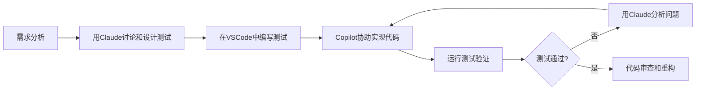

# AI时代TDD/BDD实践指南
## 用"老"方法驱动AI开发高质量代码

### 写在前面

这不是一个追求"30分钟上手"的快餐教程，而是一个稳扎稳打的学习指南。我们的目标是帮助你真正理解和掌握在AI时代如何运用TDD/BDD这两个"老"方法，让AI成为你的得力助手而不是不可控的黑盒。

---

## 第一阶段：认知重塑 - 为什么AI时代更需要测试？

### 开场：一个让人困惑的现象

假设你需要开发一个用户注册功能，包含邮箱验证、密码强度检查等。你把需求告诉AI：

**你的指令：**
```
请帮我写一个用户注册功能，需要验证邮箱格式和密码强度
```

**AI的回答：**
```javascript
function registerUser(email, password) {
    // 验证邮箱格式
    const emailRegex = /^[^\s@]+@[^\s@]+\.[^\s@]+$/;
    if (!emailRegex.test(email)) {
        return { success: false, message: "邮箱格式不正确" };
    }
    
    // 验证密码强度
    if (password.length < 8) {
        return { success: false, message: "密码至少需要8位" };
    }
    
    // 保存用户
    database.save({ email, password });
    return { success: true, message: "注册成功" };
}
```

看起来不错对吧？代码清晰，逻辑合理，AI确实很聪明。

**但是等等...** 

这个代码有什么问题呢？我们来仔细想想：
- 如果邮箱已存在怎么办？
- 密码是明文存储的吗？
- 数据库操作失败了怎么处理？
- 邮箱验证的正则表达式真的准确吗？

### 核心问题：AI很聪明，但不够"小心"

AI的强项是**模式识别和快速生成**，但它的弱项是**边界思考和错误预防**。

这就像一个聪明但缺乏经验的实习生：
- ✅ 能快速理解需求并给出看似合理的方案
- ❌ 容易忽略边界情况和潜在风险
- ❌ 不会主动考虑"如果出错了怎么办"

### AI时代的新现实

**传统开发模式：**
```
需求理解 → 设计思考 → 编码实现 → 测试验证
```

**AI加速开发模式：**
```
需求描述 → AI快速生成 → 看起来能用 → 直接部署？
```

**问题在哪？** 跳过了"深度思考"和"充分验证"环节。

### TDD/BDD：AI时代的"刹车系统"

如果把AI比作一辆高性能跑车，那么TDD/BDD就是它的刹车系统和安全保障：

**TDD的作用：**
- 强迫你在要求AI实现之前先思考"期望的行为是什么"
- 通过测试用例明确所有边界条件和异常场景
- 给AI的输出提供即时和准确的反馈

**BDD的作用：**
- 用自然语言描述业务行为，让AI更好理解上下文
- 确保开发的功能真正符合业务需求
- 为团队（包括AI）建立清晰的沟通语言

### 让我们重新来一遍

这次我们先写测试，再让AI实现：

**第一步：定义期望的行为（BDD风格）**
```gherkin
Feature: 用户注册
  
  Scenario: 成功注册新用户
    Given 一个有效的邮箱地址 "test@example.com"
    And 一个强密码 "StrongPass123!"
    When 用户提交注册信息
    Then 应该返回成功消息
    And 密码应该被加密存储
  
  Scenario: 邮箱格式无效
    Given 一个无效的邮箱地址 "invalid-email"
    When 用户提交注册信息
    Then 应该返回邮箱格式错误
    
  Scenario: 邮箱已存在
    Given 邮箱 "existing@example.com" 已经被注册
    When 用户尝试用同样邮箱注册
    Then 应该返回邮箱已存在的错误
```

**第二步：转换为具体测试用例**
```javascript
describe('用户注册功能', () => {
  test('应该成功注册新用户', async () => {
    const result = await registerUser('test@example.com', 'StrongPass123!');
    expect(result.success).toBe(true);
    expect(result.message).toContain('注册成功');
    
    // 验证密码被加密
    const user = await database.findByEmail('test@example.com');
    expect(user.password).not.toBe('StrongPass123!');
  });
  
  test('应该拒绝无效邮箱', async () => {
    const result = await registerUser('invalid-email', 'StrongPass123!');
    expect(result.success).toBe(false);
    expect(result.message).toContain('邮箱格式');
  });
  
  test('应该拒绝已存在的邮箱', async () => {
    // 先创建一个用户
    await registerUser('existing@example.com', 'StrongPass123!');
    
    // 尝试用同样邮箱注册
    const result = await registerUser('existing@example.com', 'AnotherPass123!');
    expect(result.success).toBe(false);
    expect(result.message).toContain('已存在');
  });
});
```

**第三步：让AI基于测试实现功能**
```
现在请基于上述测试用例实现registerUser函数。
注意：
1. 密码需要加密存储
2. 需要检查邮箱是否已存在
3. 要处理数据库操作可能的异常
```

**AI的新实现：**
```javascript
const bcrypt = require('bcrypt');

async function registerUser(email, password) {
    try {
        // 验证邮箱格式
        const emailRegex = /^[^\s@]+@[^\s@]+\.[^\s@]+$/;
        if (!emailRegex.test(email)) {
            return { success: false, message: "邮箱格式不正确" };
        }
        
        // 验证密码强度
        if (password.length < 8) {
            return { success: false, message: "密码至少需要8位" };
        }
        
        // 检查邮箱是否已存在
        const existingUser = await database.findByEmail(email);
        if (existingUser) {
            return { success: false, message: "邮箱已存在" };
        }
        
        // 加密密码
        const hashedPassword = await bcrypt.hash(password, 10);
        
        // 保存用户
        await database.save({ email, password: hashedPassword });
        return { success: true, message: "注册成功" };
        
    } catch (error) {
        console.error('注册过程中发生错误:', error);
        return { success: false, message: "注册失败，请稍后重试" };
    }
}
```

### 对比效果

**第一次（直接让AI实现）：**
- ❌ 没有考虑邮箱重复的情况
- ❌ 密码明文存储
- ❌ 没有异常处理
- ❌ 边界情况考虑不足

**第二次（测试驱动）：**
- ✅ 完整考虑了各种场景
- ✅ 密码加密存储
- ✅ 包含异常处理
- ✅ 每个需求都有对应验证

### 关键洞察：测试是你与AI沟通的"合同"

当你写测试时，你实际上在告诉AI：
- "这些是我关心的所有情况"
- "这些是正确的行为标准"
- "如果这些测试都通过了，我就认为你的实现是正确的"

测试用例就像是你和AI签订的一份详细合同，明确了双方的期望和责任。

### 小结：认知转变的关键点

1. **AI不是万能的**：它很聪明但不够小心，容易遗漏边界情况
2. **测试是AI的安全网**：帮助发现和修复AI输出中的问题
3. **TDD/BDD是沟通工具**：帮助你更清晰地向AI表达需求
4. **质量需要主动保障**：不能因为代码是AI写的就放松质量要求

**接下来**我们将学习如何与AI进行有效的TDD/BDD协作。

---

## 第二阶段：协作模式 - 如何与AI进行有效的TDD/BDD协作

### AI协作的基本原则

在这个阶段，我们要学会把AI当作一个聪明但需要指导的合作伙伴，而不是一个全能的代码生成器。

**基本协作模式：**
```
你：思考者 + 质量把关者
AI：实现者 + 快速迭代器
测试：沟通桥梁 + 质量标准
```

### 原则1：先思考，再生成

**错误的做法：**
"帮我写一个购物车功能"

**正确的做法：**
1. 先分析需求的各个方面
2. 列出所有需要考虑的场景
3. 设计测试用例
4. 让AI基于测试实现

**实践练习：设计购物车功能**

**第一步：需求分析**
购物车功能需要考虑什么？让我们列一个清单：
- 添加商品到购物车
- 修改商品数量
- 删除商品
- 计算总价
- 处理商品库存不足的情况
- 处理商品价格变化的情况
- 购物车持久化

**第二步：设计BDD场景**
```gherkin
Feature: 购物车管理

  Scenario: 添加商品到购物车
    Given 购物车是空的
    When 我添加1个价格为100元的商品A
    Then 购物车应该包含1个商品A
    And 总价应该是100元

  Scenario: 修改商品数量
    Given 购物车中有1个商品A
    When 我将商品A的数量改为3
    Then 购物车中应该有3个商品A
    And 总价应该相应更新

  Scenario: 库存不足时添加商品
    Given 商品B的库存只有2个
    When 我尝试添加5个商品B到购物车
    Then 应该显示库存不足的提示
    And 购物车中不应该添加商品B
```

**第三步：转换为测试用例**
```javascript
describe('购物车功能', () => {
  let cart;
  
  beforeEach(() => {
    cart = new ShoppingCart();
  });
  
  test('应该能添加商品到购物车', () => {
    const product = { id: 1, name: '商品A', price: 100 };
    
    cart.addItem(product, 1);
    
    expect(cart.getItems()).toHaveLength(1);
    expect(cart.getTotalPrice()).toBe(100);
  });
  
  test('应该能修改商品数量', () => {
    const product = { id: 1, name: '商品A', price: 100 };
    cart.addItem(product, 1);
    
    cart.updateQuantity(1, 3);
    
    expect(cart.getItemQuantity(1)).toBe(3);
    expect(cart.getTotalPrice()).toBe(300);
  });
  
  test('库存不足时应该拒绝添加', async () => {
    const product = { id: 2, name: '商品B', price: 50, stock: 2 };
    
    const result = await cart.addItem(product, 5);
    
    expect(result.success).toBe(false);
    expect(result.message).toContain('库存不足');
    expect(cart.getItems()).toHaveLength(0);
  });
});
```

**第四步：让AI实现功能**
```
请基于上述测试用例实现ShoppingCart类。
要求：
1. 支持添加、更新、删除商品
2. 正确计算总价
3. 处理库存验证
4. 所有测试都要通过
```

### 原则2：迭代式对话，不要期望一次完美

AI很强大，但复杂功能通常需要多轮对话才能达到理想效果。

**有效的迭代模式：**

**第一轮：基础实现**
```
AI，请实现一个基础的ShoppingCart类，先让基本的添加和计算功能测试通过。
```

**第二轮：完善功能**
```
很好！现在请添加库存验证功能，确保相关测试通过。注意需要异步处理。
```

**第三轮：优化和重构**
```
功能都实现了，现在请重构代码，让它更加清晰和可维护。可以考虑：
1. 提取常量和配置
2. 改善错误处理
3. 添加适当的注释
```

### 原则3：验证AI输出，不要盲目信任

即使测试通过了，你仍然需要检查AI的实现是否合理。

**检查清单：**
- [ ] 代码逻辑是否清晰易懂？
- [ ] 异常处理是否充分？
- [ ] 性能考虑是否合理？
- [ ] 是否遵循了项目的编码规范？
- [ ] 是否存在安全隐患？

**示例：发现并修复AI的不当实现**

假设AI给出了这样的实现：
```javascript
class ShoppingCart {
  constructor() {
    this.items = [];
  }
  
  addItem(product, quantity) {
    // AI的实现：每次添加都创建新条目
    this.items.push({ product, quantity });
  }
  
  getTotalPrice() {
    return this.items.reduce((total, item) => 
      total + item.product.price * item.quantity, 0);
  }
}
```

**问题发现：**
如果同一个商品添加多次，会创建多个条目而不是合并数量。

**改进指导：**
```
AI，我发现一个问题：如果用户多次添加同一个商品，应该合并数量而不是创建多个条目。
请修改addItem方法来处理这种情况。
```

### 原则4：用自然语言描述复杂逻辑

对于复杂的业务逻辑，用BDD的Given-When-Then格式可以更清楚地向AI表达需求。

**复杂场景示例：促销优惠计算**

```gherkin
Feature: 购物车优惠计算

  Scenario: 满减优惠
    Given 有一个满100减20的优惠活动
    And 购物车中商品总价为150元
    When 应用优惠
    Then 最终价格应该是130元
    And 优惠明细应该显示"满100减20"

  Scenario: 多级满减
    Given 有满减优惠：满100减10，满200减30
    And 购物车中商品总价为250元
    When 应用优惠
    Then 应该应用满200减30的优惠
    And 最终价格应该是220元

  Scenario: 优惠券和满减叠加
    Given 有满100减20的活动
    And 用户有一张10元优惠券
    And 购物车总价150元
    When 同时应用满减和优惠券
    Then 最终价格应该是120元
    And 应该显示两项优惠明细
```

**对应的AI指导：**
```
请实现购物车的优惠计算功能，需要支持：
1. 满减优惠（可能有多个档次）
2. 优惠券
3. 多种优惠的叠加计算
4. 优惠明细的记录

请确保上述所有BDD场景都能正确处理。
```

### 实践技巧汇总

**1. 好的测试用例特征：**
- ✅ 具体而明确（使用具体的数值和期望结果）
- ✅ 覆盖边界情况（空值、极限值、异常情况）
- ✅ 业务意义清晰（每个测试都对应一个具体的业务场景）
- ✅ 独立可执行（不依赖其他测试的执行结果）

**2. 与AI对话的技巧：**
- 📝 分步骤提需求，不要一次性要求太多功能
- 🔄 及时反馈和调整，通过多轮对话完善实现
- 📋 提供具体的验收标准，而不是模糊的要求
- 🧪 始终以测试通过作为实现正确的基准

**3. 常见陷阱避免：**
- ❌ 不要因为AI很聪明就跳过思考环节
- ❌ 不要因为测试通过了就不审查代码质量
- ❌ 不要一次性要求实现所有功能
- ❌ 不要忽视非功能性需求（性能、安全、可维护性）

### 小结：掌握协作模式的关键

1. **你是设计师，AI是实施者**：发挥各自的优势
2. **测试是沟通语言**：通过测试清晰表达需求
3. **迭代改进**：复杂功能需要多轮对话才能完善
4. **质量把关**：始终保持对AI输出的审查和验证

**接下来**我们将学习具体的工具使用和项目实施技能。

---

## 第三阶段：实践技能 - 工具选择与项目应用

到了这个阶段，你已经理解了为什么需要AI+TDD/BDD，也掌握了基本的协作思维。现在我们来学习具体的工具使用和在真实项目中的应用。

### 工具选择：根据需求选择，而不是追求最新

市面上有很多AI编码工具，但我们要根据实际需求来选择，而不是盲目追求最新或最炫酷的工具。

**选择工具的三个维度：**

**1. 学习成本 vs 功能完整性**
**2. 团队协作 vs 个人使用**
**3. 项目规模 vs 工具复杂度**

### 入门级工具组合：适合个人学习和小项目

**核心组合：VSCode + GitHub Copilot + Claude**

**为什么选择这个组合：**
- VSCode：大多数人熟悉，插件生态丰富
- GitHub Copilot：与编辑器深度集成，上下文理解好
- Claude：对话能力强，适合复杂逻辑的讨论和分析

**设置步骤：**

**1. 配置GitHub Copilot**
```javascript
// 在VSCode中安装Copilot扩展后
// 创建一个简单的测试文件来验证
describe('Calculator', () => {
  test('should add two numbers', () => {
    // Copilot会自动建议实现
    const calc = new Calculator();
    expect(calc.add(2, 3)).toBe(5);
  });
});
```

**2. 建立与Claude的协作流程**

在Claude中创建一个项目助手：
```
你是我的TDD/BDD编程助手。我会把测试需求和代码发给你，请你帮我：
1. 分析测试覆盖是否充分
2. 基于测试实现功能代码
3. 建议代码改进和重构方案
4. 发现潜在的问题和边界情况

我正在开发：[项目描述]
使用技术栈：[技术栈说明]
```

**实际工作流程：**



### 进阶级工具组合：适合团队协作和中大型项目

**核心组合：Cursor + Claude Code + 团队规范文档**

**升级的原因：**
- Cursor：AI原生编辑器，TDD流程更流畅
- Claude Code：更强的上下文理解和代码分析能力
- 团队规范：确保AI输出符合团队标准

**团队规范文档示例：**

创建 `TEAM_STANDARDS.md`：
```markdown
# 团队开发规范

## 测试编写标准
- 测试名称使用 should_[期望行为]_when_[条件] 格式
- 每个功能至少包含正常流程、边界情况、异常处理三类测试
- 使用Given-When-Then注释结构组织复杂测试

## 代码风格
- 优先使用函数式编程风格
- 错误处理使用Result<T, E>模式，避免抛出异常
- 异步操作必须有超时处理

## AI协作规范
- 复杂逻辑先写BDD场景，再让AI实现
- AI生成的代码必须通过人工代码审查
- 关键业务逻辑的测试必须人工验证
```

**在Cursor中配置团队规范：**
1. 将团队规范文档加入项目根目录
2. 在Cursor设置中引用这个文档
3. 每次与AI对话时，AI会自动参考这些规范

### 真实项目应用：电商订单系统案例

让我们通过一个真实的项目案例来演示完整的TDD/BDD流程。

**项目背景：**
开发一个电商平台的订单处理系统，需要处理订单创建、支付、库存扣减、发货等流程。

**第一步：业务分析和BDD场景设计**

```gherkin
Feature: 订单处理流程

  Scenario: 成功创建并处理订单
    Given 用户在购物车中有商品
    And 所有商品都有足够库存
    And 用户有有效的支付方式
    When 用户提交订单
    Then 订单应该被创建
    And 库存应该被预扣减
    And 支付应该被处理
    And 用户应该收到确认邮件

  Scenario: 库存不足时创建订单
    Given 用户购物车中有商品A（需要5个）
    And 商品A的库存只有3个
    When 用户尝试提交订单
    Then 订单创建应该失败
    And 应该显示库存不足的具体信息
    And 购物车状态不应该改变

  Scenario: 支付失败时的处理
    Given 订单已创建且库存已预扣
    When 支付处理失败
    Then 订单状态应该变为支付失败
    And 预扣的库存应该被释放
    And 用户应该收到支付失败通知
```

**第二步：设计系统架构和测试结构**

与Claude讨论系统设计：
```
我需要设计一个订单处理系统，基于上述BDD场景。
请帮我设计：
1. 主要的类和接口
2. 测试结构和测试策略
3. 需要模拟的外部依赖

系统需要处理：订单、库存、支付、通知等模块
```

Claude的建议（精简版）：
```typescript
// 主要接口设计
interface OrderService {
  createOrder(userId: string, items: CartItem[]): Promise<Result<Order, OrderError>>;
}

interface InventoryService {
  reserveStock(items: CartItem[]): Promise<Result<Reservation, InventoryError>>;
  releaseReservation(reservationId: string): Promise<void>;
}

interface PaymentService {
  processPayment(orderId: string, amount: number): Promise<Result<Payment, PaymentError>>;
}

// 测试结构建议
tests/
├── unit/           // 单个服务的测试
├── integration/    // 服务间协作测试
└── e2e/           // 端到端业务流程测试
```

**第三步：TDD实现核心服务**

先写测试，再实现：
```typescript
describe('OrderService', () => {
  let orderService: OrderService;
  let mockInventoryService: jest.Mocked<InventoryService>;
  let mockPaymentService: jest.Mocked<PaymentService>;
  
  beforeEach(() => {
    mockInventoryService = createMockInventoryService();
    mockPaymentService = createMockPaymentService();
    orderService = new OrderService(mockInventoryService, mockPaymentService);
  });
  
  test('should create order successfully with sufficient inventory', async () => {
    // Given
    const userId = 'user123';
    const items = [{ productId: 'prod1', quantity: 2, price: 100 }];
    mockInventoryService.reserveStock.mockResolvedValue(
      Result.ok({ reservationId: 'res123', expiresAt: new Date() })
    );
    mockPaymentService.processPayment.mockResolvedValue(
      Result.ok({ transactionId: 'tx123', status: 'completed' })
    );
    
    // When
    const result = await orderService.createOrder(userId, items);
    
    // Then
    expect(result.isOk()).toBe(true);
    const order = result.unwrap();
    expect(order.userId).toBe(userId);
    expect(order.status).toBe('completed');
    expect(mockInventoryService.reserveStock).toHaveBeenCalledWith(items);
    expect(mockPaymentService.processPayment).toHaveBeenCalledWith(
      order.id, 
      200
    );
  });
  
  test('should handle inventory shortage gracefully', async () => {
    // Given
    const items = [{ productId: 'prod1', quantity: 5, price: 100 }];
    mockInventoryService.reserveStock.mockResolvedValue(
      Result.err({ type: 'INSUFFICIENT_STOCK', details: 'Only 3 available' })
    );
    
    // When
    const result = await orderService.createOrder('user123', items);
    
    // Then
    expect(result.isErr()).toBe(true);
    const error = result.unwrapErr();
    expect(error.type).toBe('INVENTORY_ERROR');
    expect(error.message).toContain('库存不足');
  });
});
```

**第四步：让AI实现功能**

```
请基于上述测试实现OrderService类。
要求：
1. 使用Result<T, E>模式处理错误
2. 正确处理异步操作和事务
3. 包含完整的错误处理逻辑
4. 确保所有测试都能通过
```

**第五步：集成测试和端到端测试**

```typescript
// 集成测试：测试真实服务间的协作
describe('Order Processing Integration', () => {
  test('complete order flow with real services', async () => {
    // 使用真实的服务实例，但连接测试数据库
    const realOrderService = new OrderService(
      new InventoryService(testDB),
      new PaymentService(testPaymentGateway)
    );
    
    // 测试完整流程
    const result = await realOrderService.createOrder(testUserId, testItems);
    
    expect(result.isOk()).toBe(true);
    // 验证数据库状态变化
    // 验证外部服务调用
  });
});

// 端到端测试：从API到数据库的完整链路
describe('Order API E2E Tests', () => {
  test('POST /orders creates order successfully', async () => {
    const response = await request(app)
      .post('/orders')
      .send({
        userId: 'user123',
        items: [{ productId: 'prod1', quantity: 2 }]
      })
      .expect(201);
      
    expect(response.body.orderId).toBeDefined();
    expect(response.body.status).toBe('completed');
  });
});
```

### 团队协作和标准建立

**建立团队TDD/BDD实践：**

**1. 团队培训计划**
```
第一周：理念普及
- 为什么我们需要AI+TDD/BDD
- 成功案例分享
- 基本工具使用

第二周：实践练习
- 结对编程与AI协作
- Code Review标准建立
- 工具链配置统一

第三周：项目试点
- 选择一个小模块试点
- 收集反馈和问题
- 调整流程和标准

第四周：推广应用
- 全面应用到项目中
- 建立度量和改进机制
- 持续优化实践
```

**2. Code Review检查清单**
```markdown
## AI+TDD代码审查清单

### 测试质量
- [ ] 测试用例是否涵盖了所有业务场景？
- [ ] 是否包含了边界条件和异常情况？
- [ ] 测试命名是否清晰描述了测试意图？
- [ ] 测试是否独立且可重复运行？

### 代码质量
- [ ] AI生成的代码是否遵循团队规范？
- [ ] 错误处理是否充分和合理？
- [ ] 是否存在安全隐患？
- [ ] 代码可读性和可维护性如何？

### 协作过程
- [ ] 是否先写了测试再实现功能？
- [ ] AI协作过程是否记录和可追溯？
- [ ] 复杂逻辑是否有充分的设计讨论？
```

**3. 质量度量指标**
```typescript
// 团队Dashboard指标
interface TeamMetrics {
  // 效率指标
  tddCycleTime: number;           // TDD循环平均时间
  aiCollaborationEfficiency: number; // AI协作效率
  
  // 质量指标
  testCoverage: number;           // 测试覆盖率
  bugEscapeRate: number;          // 生产环境缺陷率
  codeReviewPassRate: number;     // 代码审查通过率
  
  // 学习指标
  teamSkillProgression: number;   // 团队技能提升度
  knowledgeSharing: number;       // 知识分享活跃度
}
```

### 小结：建立可持续的实践体系

1. **工具选择要务实**：根据团队现状和项目需求选择合适的工具
2. **流程要可执行**：建立清晰的工作流程和检查标准
3. **标准要明确**：通过文档和培训确保团队理解和执行一致
4. **改进要持续**：通过度量和反馈不断优化实践

**接下来**我们将深入探讨复杂场景和前沿思考。

---

## 第四阶段：进阶思考 - 复杂场景与深度理解

到了这个阶段，你已经掌握了AI+TDD/BDD的基本理论和实践技能。现在我们要深入探讨一些复杂场景，理解更深层的概念，并思考未来的发展方向。

### 深入理解：八大维度变革的系统性思考

还记得在第一阶段提到的AI时代TDD/BDD的八大变革维度吗？现在让我们深入理解这些变革的系统性影响。

#### 维度1：规格探索 - 从需求到可执行规格的质的飞跃

**深度洞察：**
传统软件开发中，需求文档和代码实现之间存在巨大的"解释鸿沟"。AI时代通过人机协作的规格探索，这个鸿沟被大幅缩小。

**复杂场景案例：微服务系统的规格协调**

假设你在开发一个复杂的电商系统，涉及用户服务、商品服务、订单服务、支付服务等多个微服务。传统方式下，各服务间的接口协调是个巨大挑战。

**AI增强的规格探索过程：**

**第一步：系统级BDD场景设计**
```gherkin
Feature: 跨服务订单处理流程

  Background:
    Given 用户服务已启动并包含用户 "张三"
    And 商品服务包含商品 "iPhone 14" 价格 5999元 库存 50个
    And 支付服务连接到模拟支付网关
    And 订单服务已启动

  Scenario: 完整的下单流程
    Given 用户 "张三" 已登录
    When 用户将 "iPhone 14" 加入购物车
    And 用户提交订单
    And 系统处理支付
    Then 订单状态应该是 "已支付"
    And 商品库存应该减少 1个
    And 用户应该收到订单确认邮件

  Scenario: 跨服务数据一致性验证
    Given 订单服务创建了订单但支付失败
    When 系统执行补偿事务
    Then 订单状态应该变为 "支付失败"
    And 商品库存应该恢复
    And 所有相关服务的数据应该保持一致
```

**与AI的协作对话：**
```
我需要基于上述BDD场景设计跨服务的API契约和数据流。
请帮我：
1. 设计服务间的API接口
2. 定义数据传输对象(DTO)
3. 设计错误处理和补偿机制
4. 生成服务间的集成测试用例

考虑要点：
- 服务解耦和数据一致性
- 分布式事务处理
- 错误传播和恢复
- 性能和超时处理
```

**AI的规格输出示例：**
```typescript
// 服务间API契约
interface OrderServiceAPI {
  createOrder(request: CreateOrderRequest): Promise<ApiResponse<Order>>;
}

interface CreateOrderRequest {
  userId: string;
  items: OrderItem[];
  paymentMethod: PaymentMethod;
  deliveryAddress: Address;
}

// 补偿事务设计
interface CompensationAction {
  serviceId: string;
  action: 'rollback' | 'retry' | 'skip';
  parameters: any;
  timeoutMs: number;
}

// 集成测试规格
describe('Cross-Service Order Processing', () => {
  test('should maintain data consistency across all services', async () => {
    // 测试实现...
  });
});
```

#### 维度2：风险洞察 - 从静态覆盖到动态风险评估

**深度洞察：**
传统的代码覆盖率是静态指标，AI时代的风险洞察是动态和智能的。它不仅看你测试了哪些代码，还分析这些代码的风险等级和业务影响。

**复杂场景：金融交易系统的风险驱动测试**

**与AI的风险分析对话：**
```
我有一个股票交易系统，包含以下模块：
1. 订单匹配引擎（高频交易，并发处理）
2. 风控系统（实时监控异常交易）
3. 清算系统（每日结算处理）
4. 用户管理（账户和权限）

请分析每个模块的风险等级，并设计相应的测试策略。
考虑因素：
- 业务影响：资金损失风险
- 技术复杂度：并发、性能、数据一致性
- 变更频率：开发活跃度
- 监管要求：合规性测试
```

**AI的风险分析报告：**
```markdown
## 风险评估报告

### 高风险模块：订单匹配引擎
风险评分：9.2/10
- 业务影响：极高（直接影响交易执行和用户资金）
- 技术复杂度：极高（高并发、微秒级延迟要求）
- 建议测试策略：
  - 并发压力测试：模拟1万个并发订单
  - 边界条件测试：价格溢出、数量边界
  - 故障注入测试：网络分区、服务重启
  - 性能基准测试：延迟、吞吐量监控

### 中高风险模块：风控系统
风险评分：7.8/10
- 业务影响：高（异常交易可能导致合规问题）
- 技术复杂度：中高（复杂规则引擎、实时计算）
- 建议测试策略：
  - 规则引擎测试：各种异常交易模式
  - 实时性测试：毫秒级风险检测
  - 误报率测试：正常交易的误判概率
```

**AI生成的风险测试用例：**
```typescript
describe('高风险场景：订单匹配引擎', () => {
  test('应该在极高并发下保持数据一致性', async () => {
    // 模拟1万个并发买卖订单
    const buyOrders = generateRandomOrders(5000, 'BUY');
    const sellOrders = generateRandomOrders(5000, 'SELL');
    
    // 并发提交所有订单
    const results = await Promise.allSettled([
      ...buyOrders.map(order => matchingEngine.submitOrder(order)),
      ...sellOrders.map(order => matchingEngine.submitOrder(order))
    ]);
    
    // 验证账户资金总和不变（守恒定律）
    const totalFundsAfter = await calculateTotalSystemFunds();
    expect(totalFundsAfter).toBe(totalFundsBefore);
    
    // 验证没有重复成交
    const allTrades = await matchingEngine.getAllTrades();
    const tradeIds = allTrades.map(t => t.id);
    expect(new Set(tradeIds).size).toBe(tradeIds.length);
  });
  
  test('应该在系统故障时安全停止交易', async () => {
    // 注入数据库连接失败
    await injectFailure('database', 'connection_timeout');
    
    const order = createTestOrder();
    const result = await matchingEngine.submitOrder(order);
    
    // 应该拒绝订单而不是部分处理
    expect(result.status).toBe('REJECTED');
    expect(result.reason).toContain('SYSTEM_ERROR');
    
    // 验证没有孤儿交易
    const pendingTrades = await matchingEngine.getPendingTrades();
    expect(pendingTrades).toHaveLength(0);
  });
});
```

#### 维度3：即时心流 - 消除认知摩擦的深层机制

**深度洞察：**
心流状态的科学基础是认知负荷理论。AI通过承担执行细节，让开发者的工作记忆可以完全专注于设计思考，这是认知科学在软件开发中的具体应用。

**复杂场景：大型遗留系统的重构**

传统重构遗留系统是最考验开发者心智负荷的任务：既要理解现有逻辑，又要设计新架构，还要确保不破坏现有功能。

**AI增强的重构心流：**

**第一阶段：理解现状**
```
AI，请分析这个1万行的订单处理类，帮我理解：
1. 主要业务逻辑流程
2. 外部依赖和耦合点
3. 潜在的代码质量问题
4. 重构的切入点建议

[附上legacy代码]
```

**第二阶段：设计测试保护网**
```
基于你的分析，请为这个类设计一套characterization tests（特征测试），
确保重构过程中不会破坏现有行为。
重点关注：
1. 所有公共方法的输入输出行为
2. 副作用（数据库写入、外部服务调用）
3. 异常情况的处理
```

**第三阶段：逐步重构**
```
现在请设计一个重构计划，将这个大类分解为多个小类。
要求：
1. 每次重构都有对应的测试验证
2. 可以增量式进行，不影响现有功能
3. 新的设计要符合SOLID原则
```

**心流保持的关键技巧：**
- 🧠 **认知分层**：AI处理细节，你专注架构
- 🔄 **即时反馈**：每个重构步骤都有测试验证
- 📝 **上下文保持**：AI记住整个重构的上下文和目标
- ⚡ **快速迭代**：小步快跑，避免大范围改动

### 复杂场景深度剖析

#### 场景1：分布式系统的测试策略

**挑战：**
- 服务间依赖复杂
- 异步处理和最终一致性
- 网络分区和故障恢复
- 性能和可伸缩性

**AI增强的解决方案：**

**Contract Testing（契约测试）的AI生成：**
```typescript
// AI基于服务API自动生成契约测试
describe('用户服务 -> 订单服务 契约', () => {
  test('获取用户信息接口契约', async () => {
    const pact = await aiGenerateContract({
      consumer: '订单服务',
      provider: '用户服务',
      interaction: {
        description: '获取用户基本信息',
        request: {
          method: 'GET',
          path: '/users/123',
          headers: { 'Authorization': 'Bearer token' }
        },
        expectedResponse: {
          status: 200,
          body: {
            id: like('123'),
            name: like('张三'),
            email: like('zhang@example.com')
          }
        }
      }
    });
    
    await pact.verify();
  });
});
```

**Chaos Engineering（混沌工程）的AI辅助：**
```typescript
// AI设计和执行混沌测试场景
describe('分布式系统弹性测试', () => {
  test('订单服务不可用时的系统行为', async () => {
    // AI分析系统依赖关系，生成故障注入方案
    const chaosScenario = await ai.designChaosTest({
      targetService: '订单服务',
      failureType: 'service_unavailable',
      expectedBehavior: 'graceful_degradation'
    });
    
    await chaosScenario.execute();
    
    // 验证系统的优雅降级行为
    expect(await systemHealthCheck()).toMatchObject({
      status: 'degraded',
      availableFeatures: ['用户管理', '商品浏览'],
      unavailableFeatures: ['下单', '支付']
    });
  });
});
```

#### 场景2：性能关键系统的测试设计

**挑战：**
- 性能要求严格（毫秒级响应）
- 资源使用优化
- 负载和压力测试
- 性能回归检测

**AI增强的性能测试：**

```typescript
describe('高频交易系统性能测试', () => {
  test('订单处理延迟应在1毫秒内', async () => {
    // AI生成真实的市场数据模拟
    const marketData = await ai.generateRealisticMarketData({
      symbol: 'AAPL',
      duration: '1hour',
      volatility: 'high'
    });
    
    const performanceResults = await benchmark({
      operation: () => tradingEngine.processOrder(testOrder),
      iterations: 10000,
      warmupIterations: 1000
    });
    
    expect(performanceResults.p99Latency).toBeLessThan(1); // 毫秒
    expect(performanceResults.memoryLeakRate).toBeLessThan(0.1); // MB/s
  });
  
  test('系统应在高负载下保持稳定', async () => {
    // AI设计压力测试场景
    const loadTest = await ai.designLoadTest({
      targetTPS: 50000,
      duration: '5minutes',
      userBehaviorPattern: 'realistic_trading'
    });
    
    const results = await loadTest.execute();
    
    expect(results.errorRate).toBeLessThan(0.001); // 0.1%
    expect(results.avgResponseTime).toBeLessThan(10); // 毫秒
  });
});
```

### 团队规模化：从个人实践到组织能力

#### 建立组织级的AI+TDD/BDD实践

**1. 知识管理系统**
```typescript
// 团队知识库结构
interface TeamKnowledgeBase {
  bestPractices: {
    testingPatterns: TestPattern[];
    aiPromptTemplates: PromptTemplate[];
    commonPitfalls: Pitfall[];
  };
  
  projectTemplates: {
    testStructures: TestStructure[];
    cicdPipelines: Pipeline[];
    qualityGates: QualityGate[];
  };
  
  learningResources: {
    tutorials: Tutorial[];
    caseStudies: CaseStudy[];
    troubleshooting: TroubleshootingGuide[];
  };
}
```

**2. 质量度量和改进**
```typescript
// 团队效能度量
interface TeamEfficiencyMetrics {
  developmentVelocity: {
    beforeAI: number;
    afterAI: number;
    improvementRate: number;
  };
  
  codeQuality: {
    bugEscapeRate: number;
    testCoverage: number;
    technicalDebtRatio: number;
  };
  
  teamSkills: {
    aiCollaborationProficiency: number;
    testDesignQuality: number;
    codeReviewEffectiveness: number;
  };
}
```

**3. 持续改进机制**
```gherkin
Feature: 团队实践持续改进

  Scenario: 月度实践回顾
    Given 团队完成了一个月的AI+TDD实践
    When 进行实践回顾会议
    Then 应该收集效率和质量数据
    And 识别改进机会
    And 更新最佳实践文档
    And 制定下月改进目标

  Scenario: 新技术引入评估
    Given 出现了新的AI工具或技术
    When 团队评估其引入价值
    Then 应该进行小范围试点
    And 评估对现有流程的影响
    And 基于试点结果决定是否推广
```

### 未来展望：AI+TDD/BDD的发展方向

#### 技术演进趋势

**1. 更智能的测试生成**
- AI将能够从用户行为数据中自动生成测试场景
- 基于代码变更的影响分析，智能选择需要运行的测试
- 自动发现和修复测试中的反模式

**2. 实时质量反馈**
- 在编写代码的同时实时评估质量和风险
- 基于历史数据预测代码的潜在问题
- 自动建议最优的测试策略

**3. 跨团队协作增强**
- AI作为团队间的翻译器，自动同步不同团队的测试标准
- 智能的跨项目最佳实践共享
- 自动化的知识提取和传播

#### 新的挑战和机遇

**挑战：**
- AI生成代码的可解释性和可信度
- 过度依赖AI导致的技能退化风险
- 复杂系统中AI决策的责任归属

**机遇：**
- 软件质量的大幅提升
- 开发效率的显著改善
- 更多精力投入到创新和业务价值创造

### 小结：成为AI时代的卓越开发者

通过这四个阶段的学习，你应该已经：

1. **认知转变**：理解AI时代软件开发的本质变化
2. **技能掌握**：会与AI进行有效的TDD/BDD协作
3. **实践应用**：能在真实项目中应用相关技术
4. **深度理解**：对复杂场景和前沿趋势有独立思考

**最重要的是**：你已经建立了一种新的开发思维模式，能够与AI协作开发出高质量的软件，并且能够适应技术的持续演进。

**记住**：AI是工具，TDD/BDD是方法，但创造价值的始终是人。在AI时代，优秀的开发者不是被AI替代，而是学会如何更好地利用AI来实现更大的价值创造。

---

## 总结：稳扎稳打的AI时代开发之路

这个指南没有承诺"30分钟上手"，而是带你走过了一条稳扎稳打的学习之路：

- **从认知开始**，理解为什么而不是如何
- **重视协作**，学会与AI有效沟通
- **注重实践**，在真实场景中应用技能
- **持续思考**，对复杂问题保持探索精神

在AI快速发展的时代，保持学习的心态，掌握与AI协作的能力，将TDD/BDD这些经过时间检验的"老"方法与最新的AI技术结合，你就能在这个变革的时代中保持竞争力，创造更大的价值。

**愿你成为AI时代的卓越开发者！**