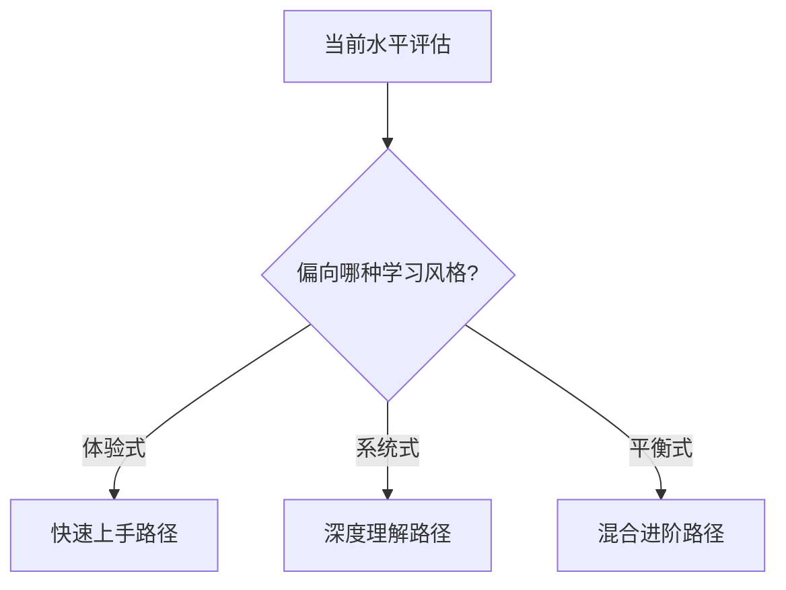

# AI时代TDD/BDD教学框架 - 方案3：对比揭示式
## 2小时PPT教学大纲

---

## 教学目标与受众分析

**目标受众**：
- 各层级的开发者（新手到资深）
- 感性认知较强，更容易被故事和情感打动
- 需要激发学习动力和紧迫感
- 喜欢通过对比和案例理解抽象概念

**核心教学目标**：
- 通过强烈对比激发学员的学习动力
- 让学员在故事中看到自己，产生认同感
- 展示AI+TDD的具体价值和实践方法
- 提供明确的成长路径和避坑指南

**教学特色**：
- 故事性强，易于记忆和传播
- 情感冲击力大，激发行动力
- 对比鲜明，说服力强
- 实用性强，立即可行

---

## 第一部分：双城记开场 - 两个开发者的平行故事（20分钟）

### 故事背景设置
**幻灯片1：时间线**
```
2024年3月 ────── 2024年9月
    ↓                ↓
  起点相同          结果迥异
```

**幻灯片2-3：人物介绍**
- **小明**：5年开发经验，技术基础扎实，勤奋上进
- **小华**：同样5年经验，同一家公司，技术水平相当
- **共同点**：都在2024年3月开始接触AI编程工具

### 小明的故事：AI依赖陷阱（10分钟）

**幻灯片4-5：小明的初体验**
> "哇，GitHub Copilot好厉害！写代码比我还快！"

**3月份的兴奋期**：
- 第一次用Copilot自动补全代码
- 效率明显提升，感觉找到了"捷径"
- 团队leader表扬："小明最近进步很快啊"

**幻灯片6-7：小明的工作方式**
```
需求来了 → 直接让AI写代码 → 看起来能跑 → 提交上线
```

**典型的一天**：
- 接到需求：用户密码重置功能
- Copilot建议：直接生成完整代码
- 测试：点几下，没报错
- 上线：功能正常运行

**幻灯片8-9：6个月后的现状**
**7月开始出现问题**：
- 用户反馈：密码重置邮件有时收不到
- 生产环境：偶发的500错误
- 代码审查：同事指出安全隐患

**9月的困境**：
- 线上Bug频发，客户投诉增多
- 代码维护困难："这段代码我也不太懂"
- 技术债务积累：新功能越来越难加
- 团队信任下降：leader开始质疑他的能力
- 内心焦虑：对AI又爱又恨，担心离开AI就不会写代码

**幻灯片10：小明的内心独白**
> "AI让我写代码变快了，但我感觉自己变弱了...
> 我越来越不敢离开AI，但用AI写的代码又总是出问题。
> 我到底哪里做错了？"

### 小华的故事：协作增强之路（10分钟）

**幻灯片11-12：小华的思考**
> "AI很厉害，但我觉得还不够。
> 它能写代码，但知道什么是'对的'代码吗？"

**3月份的谨慎开始**：
- 同样被Copilot的能力震撼
- 但选择了不同的使用方式
- 花时间研究"如何更好地与AI协作"

**幻灯片13-14：小华的工作方式**
```
需求分析 → 思考边界 → 设计测试 → AI协作实现 → 验证质量
```

**典型的一天（同样是密码重置功能）**：
- 接到需求后，先思考：可能出现什么问题？
- 设计测试场景：正常流程、邮箱不存在、邮件发送失败...
- 与Claude对话："基于这些测试，实现密码重置功能"
- AI生成代码，但有测试兜底
- 发现问题，持续迭代优化

**幻灯片15-16：小华的学习过程**
**4-5月：建立方法论**
- 学习TDD/BDD基础概念
- 探索不同AI工具的协作方式
- 总结出一套自己的工作流程

**6-7月：实践和优化**
- 在实际项目中应用新方法
- 遇到问题就优化流程
- 开始帮助团队其他成员

**幻灯片17-18：9月的收获**
**技术成果**：
- 代码质量稳步提升，Bug率下降60%
- 新功能开发速度不减反增
- 成为团队的AI+TDD专家

**个人成长**：
- 对新技术有强烈的把握能力
- 开始在公司内分享经验
- 获得晋升机会
- 内心自信：掌握了与AI协作的密码

**幻灯片19：小华的感悟**
> "AI不是来替代我的，而是来增强我的。
> 关键是要学会做AI的'教练'，而不是AI的'学生'。"

### 互动环节1：自我对照
**幻灯片20：现实检查**
**提问给学员**：
- "听了这两个故事，你们觉得自己更像小明还是小华？"
- "你们在使用AI工具时，更多采用哪种方式？"
- "有没有遇到过类似小明的困扰？"

**预期反应**：
- 大部分学员会承认更像小明
- 产生紧迫感："我不想成为失败的小明"
- 好奇心："小华的秘密武器到底是什么？"

**学员心理状态**：
- 认同感：在小明身上看到自己
- 紧迫感：担心重蹈小明覆辙
- 好奇心：渴望了解小华的方法

---

## 第二部分：解密小华的秘密武器（35分钟）

### 秘密1：思维模式的根本差异（10分钟）

**幻灯片21-22：两种思维模式对比**

**小明的思维模式**：
```
AI = 高级代码生成器
我的工作 = 提供需求 + 验收结果
```

**小华的思维模式**：
```
AI = 协作伙伴
我的工作 = 设计方案 + 指导实现 + 质量把关
```

**幻灯片23：关键差异表格**
| 维度 | 小明（工具思维） | 小华（伙伴思维） |
|------|------------------|------------------|
| 对AI的定位 | 代码生成器 | 智能助手 |
| 自己的角色 | 需求提供者 | 方案设计师 |
| 质量保障 | 事后测试 | 事前设计 |
| 学习态度 | 依赖AI | 与AI共成长 |

**幻灯片24：思维转变的关键**
> **从"用AI写代码"到"与AI协作开发"**
> - 不是让AI替代思考，而是让AI放大思考
> - 不是信任AI的输出，而是验证AI的输出
> - 不是依赖AI的经验，而是结合自己的判断

### 秘密2：测试先行的威力（15分钟）

**幻灯片25-26：同一需求，不同处理**
**需求**：用户登录功能（带防暴力破解）

**小明的处理方式**：
```
1. 直接提问：帮我写个带防暴力破解的登录功能
2. AI输出代码
3. 简单测试：输入正确密码，能登录成功 ✓
4. 上线
```

**小华的处理方式**：
```
1. 先设计测试场景：
   - 正确密码应该登录成功
   - 错误密码应该返回失败信息
   - 连续5次错误应该锁定账户
   - 锁定期间正确密码也不能登录
   - 锁定时间过后应该可以重新尝试
2. 与AI对话实现
3. 运行所有测试确保完整性
```

**幻�灯片27-28：现场代码对比**

**小明版本（AI直接生成）**：
```javascript
function login(username, password) {
  const user = database.findUser(username);
  if (user && user.password === password) {
    return { success: true, user: user };
  }
  // 简单的失败计数
  user.failCount = (user.failCount || 0) + 1;
  if (user.failCount >= 5) {
    user.locked = true;
  }
  return { success: false, message: "登录失败" };
}
```

**问题分析**：
- ❌ 密码明文比较
- ❌ 没有锁定时间概念
- ❌ 成功登录后没有重置失败计数
- ❌ 没有考虑并发情况

**小华版本（测试驱动）**：
```javascript
// 先有测试用例
describe('用户登录', () => {
  test('正确密码应该登录成功且重置失败计数', () => {
    // Given
    const user = { username: 'test', password: hashedPassword, failCount: 3 };
    
    // When
    const result = login('test', 'correctPassword');
    
    // Then
    expect(result.success).toBe(true);
    expect(user.failCount).toBe(0); // 成功后重置
  });
  
  test('连续5次失败应锁定30分钟', () => {
    // 具体测试逻辑...
  });
});

// AI基于测试生成的实现
function login(username, password) {
  const user = database.findUser(username);
  
  // 检查是否被锁定
  if (user.lockedUntil && user.lockedUntil > new Date()) {
    return { success: false, message: "账户已锁定" };
  }
  
  // 验证密码
  if (bcrypt.compare(password, user.hashedPassword)) {
    // 成功：重置失败计数
    user.failCount = 0;
    user.lockedUntil = null;
    return { success: true, user: sanitizeUser(user) };
  }
  
  // 失败：增加计数并检查是否需要锁定
  user.failCount = (user.failCount || 0) + 1;
  if (user.failCount >= 5) {
    user.lockedUntil = new Date(Date.now() + 30 * 60 * 1000); // 30分钟
  }
  
  return { success: false, message: "用户名或密码错误" };
}
```

**幻灯片29：质量对比**
| 维度 | 小明版本 | 小华版本 |
|------|----------|----------|
| 密码安全 | ❌ 明文 | ✅ 加密 |
| 锁定机制 | ❌ 永久锁定 | ✅ 时间锁定 |
| 成功重置 | ❌ 未考虑 | ✅ 自动重置 |
| 并发安全 | ❌ 有风险 | ✅ 考虑周全 |
| 测试覆盖 | ❌ 不充分 | ✅ 全场景 |

### 秘密3：人机协作的艺术（10分钟）

**幻灯片30-31：对话模式的差异**

**小明与AI的对话**：
```
小明：帮我写个用户注册功能
AI：[生成代码]
小明：好的，我用了
```
（一次性交易，缺乏迭代）

**小华与AI的对话**：
```
小华：我需要实现用户注册，先帮我分析一下需要考虑哪些场景？
AI：需要考虑邮箱格式验证、密码强度、重复注册等...
小华：很好，请基于这些场景帮我设计测试用例
AI：[生成测试用例]
小华：测试用例不错，但我觉得还缺少并发注册的测试，请补充
AI：[补充测试]
小华：现在请基于完整的测试实现注册功能
AI：[生成实现代码]
小华：代码不错，但我看到有个地方可能有性能问题...
```
（持续对话，不断优化）

**幻灯片32-33：协作原则**

**小华的协作原则**：
1. **AI是助手，不是替代**：保持自己的思考和判断
2. **测试是合同，不是装饰**：用测试明确表达期望
3. **迭代是常态，不是失败**：通过多轮对话完善方案
4. **验证是必须，不是选择**：永远验证AI的输出

**关键洞察**：
> **测试用例 = 人机沟通的"合同"**
> - 明确了人类的期望
> - 给AI提供了精确的上下文
> - 创造了质量验证的标准

### 互动环节2：方法内化
**幻灯片34：思考讨论**
- "小华的方法哪个部分让你印象最深？"
- "你觉得在自己的工作中，哪个环节最容易改进？"
- "有没有类似的协作经验？"

**学员心理状态**：
- 恍然大悟：原来差别在这里
- 技能焦虑：我需要学会新的协作方式
- 工具渴望：想要尝试这种工作模式

---

## 第三部分：AI时代软件开发的新范式（35分钟）

### 从个人手艺到人机协作（12分钟）

**幻灯片35-36：软件开发的历史演进**

**手工时代（1970s-1990s）**：
- 个人英雄主义
- 依赖经验和直觉
- 知识存在个人头脑中

**工程化时代（1990s-2010s）**：
- 流程化和标准化
- 团队协作和知识共享
- 工具和框架的普及

**AI协作时代（2020s+）**：
- 人机协作成为核心
- 智能化工具深度集成
- 认知负荷重新分配

**幻灯片37-38：核心转变对比**

```
传统模式：人 → 代码 → 系统
AI模式：人 ↔ AI → 代码 → 系统
```

**转变的本质**：
- 人的角色：从执行者变为设计师
- AI的角色：从工具变为伙伴
- 代码的属性：从手工艺品变为协作产品

**幻灯片39-40：价值重新定义**

**传统开发者价值**：
- 熟悉语法和API
- 快速编写代码
- 调试和修复问题

**AI时代开发者价值**：
- 理解业务和需求
- 设计架构和方案
- 质量把控和决策

**案例说明**：
- 小明困在传统价值观里：追求写代码快
- 小华抓住新价值观：追求方案好

### 从代码覆盖到风险洞察（12分钟）

**幻灯片41-42：传统测试的盲点**

**小明的测试观**：
- "我的代码覆盖率有85%，应该很安全了"
- 关注数字指标
- 平均分配测试资源

**现实的残酷真相**：
```
覆盖率100%的代码，仍然有30%的关键Bug未发现
```

**幻灯片43-44：小华的风险思维**

**小华的测试观**：
- "哪些代码最容易出问题？"
- "什么样的Bug影响最大？"
- "如何用最少的测试覆盖最多的风险？"

**风险驱动的测试策略**：
```
测试投入 ∝ 代码风险 × 业务影响
```

**幻灯片45-46：AI增强的风险识别**

**演示案例：电商系统风险分析**
1. **CodeScene分析**：识别出支付模块是"热点代码"
   - 复杂度高（圈复杂度15）
   - 修改频繁（近3月修改12次）
   - 业务关键（涉及资金）

2. **Claude深度分析**：
   ```
   支付模块存在以下风险：
   - 并发处理：多个订单同时支付可能导致重复扣款
   - 异常处理：第三方支付超时时的状态不一致
   - 数据一致性：支付成功但订单状态更新失败
   ```

3. **AI生成针对性测试**：
   - 并发支付测试
   - 超时重试测试
   - 状态一致性测试

**效果对比**：
- 小明方式：平均测试，80%覆盖率，仍有关键Bug
- 小华方式：风险聚焦，60%覆盖率，关键风险全覆盖

### 从纪律约束到即时心流（11分钟）

**幻灯片47-48：传统TDD的心理负担**

**小明的TDD体验**：
- "TDD太繁琐了，要来回切换文件"
- "写测试比写代码还累"
- "一个功能要写2倍的代码"
- 最终：坚持不下去，放弃TDD

**幻灯片49-50：小华的TDD体验**

**小华的工具选择**：Cursor + Claude
- 测试和实现在同一窗口
- AI自动生成测试骨架
- 一键运行和反馈

**现场演示（5分钟）**：
**传统TDD vs AI增强TDD**

*场景：添加商品到购物车功能*

**传统方式演示**：
1. 创建test文件 → 30秒
2. 手写测试代码 → 90秒
3. 切换到src文件 → 10秒
4. 手写实现代码 → 120秒
5. 运行测试 → 15秒
6. 调试修复 → 60秒
**总计：325秒（5分25秒）**

**AI增强方式演示**：
1. 写测试意图注释 → 10秒
2. Claude生成测试 → 5秒
3. AI生成实现 → 5秒
4. 自动运行测试 → 3秒
5. AI建议优化 → 10秒
**总计：33秒**

**幻灯片51-52：体验转变的本质**

**从"纪律"到"乐趣"**：
- 传统：需要意志力坚持
- AI增强：自然而然的流程

**从"负担"到"助力"**：
- 传统：测试是额外工作
- AI增强：测试是思考工具

**小华的感悟**：
> "现在我不是在'写测试'，而是在'设计软件'。
> 测试成了我思考的方式，AI成了我的执行手臂。"

---

## 第四部分：如何成为小华 - 实践路径设计（25分钟）

### 现状评估：你现在在哪里？（8分钟）

**幻灯片53-54：发展阶段识别**

**互动练习：能力测试**
```javascript
// 给定这个需求，你会怎么开始？
需求：实现一个简单的库存管理系统
- 可以添加商品
- 可以更新库存数量  
- 库存不足时要警告
- 支持批量操作
```

**学员回答分类**：

**小明阶段（初级）**：
- "我会让Copilot帮我写一个库存管理的类"
- 直接想到实现，没有考虑测试
- 关注功能实现，忽视边界情况

**过渡阶段（中级）**：
- "我会先想想需要哪些方法，然后写实现"
- 有一些设计思考，但测试不系统
- 开始意识到边界情况

**小华阶段（高级）**：
- "我会先设计测试场景：正常添加、重复添加、负数库存、批量操作的原子性..."
- 测试驱动思考，系统考虑各种情况
- AI协作而非依赖

**幻灯片55：个性化路径图**


### 具体成长路径（12分钟）

**幻灯片56-58：路径A - 快速体验路径（适合小明阶段）**

**第1周：震撼体验**
- **目标**：体验小华式的开发流程
- **具体行动**：
  - 安装Cursor + Claude
  - 找一个简单功能（如计算器）
  - 先写3个测试场景，再让AI实现
  - 感受测试驱动的差异

**第2-3周：建立习惯**
- **目标**：将新方式内化为自然反应
- **具体行动**：
  - 每天一个小练习
  - 重点：先想测试，再求实现
  - 记录：对比新旧方式的差异感受

**第4周：实战应用**
- **目标**：在真实工作中应用
- **具体行动**：
  - 选择一个工作中的小功能
  - 完全按小华的方式开发
  - 总结：效果和遇到的挑战

**幻灯片59-61：路径B - 深度理解路径（适合有基础者）**

**第1-2周：理论建构**
- 深入学习TDD/BDD的核心思想
- 理解AI时代的根本变化
- 研究小华背后的方法论

**第3-4周：工具精通**
- 掌握AI协作的各种技巧
- 建立个人的工作流模板
- 优化工具链配置

**第5-8周：项目实践**
- 在实际项目中全面应用
- 建立团队最佳实践
- 开始指导其他团队成员

**幻灯片62-63：路径C - 混合进阶路径**

**灵活组合**：
- 30%时间体验新方法
- 40%时间理论学习
- 30%时间实践应用

**螺旋上升**：
- 每个概念都会重复出现
- 每次重复都加深理解
- 逐步建立完整体系

### 工具选择和第一步行动（5分钟）

**幻灯片64：工具推荐矩阵**
| 发展阶段 | IDE选择 | AI助手 | 测试框架 |
|----------|---------|--------|----------|
| 小明阶段 | Cursor | Claude | Jest/简单框架 |
| 过渡阶段 | VSCode+Copilot | GPT-4/Claude | 项目相关框架 |
| 小华阶段 | 个人偏好 | 多工具组合 | 完整测试栈 |

**幻灯片65：今晚回家就能做的3件事**
1. **下载Cursor**（或配置现有工具的AI插件）
2. **练习小华式对话**：
   ```
   不要说："帮我写个登录功能"
   而要说："我需要实现登录功能，请先帮我分析需要考虑哪些测试场景"
   ```
3. **加入学习社区**：获得持续支持和交流

### 避坑指南：不要重蹈小明覆辙
**幻灯片66-67：常见陷阱和应对**

| 陷阱 | 表现 | 小明的做法 | 小华的做法 |
|------|------|------------|------------|
| 过度依赖 | 离开AI就不会写代码 | 依赖AI生成一切 | 用AI增强自己的思考 |
| 工具焦虑 | 频繁更换最新工具 | 追求最新最酷 | 选定工具深入掌握 |
| 质量忽视 | 只要能跑就行 | 测试点几下就算 | 系统设计验证标准 |
| 孤立学习 | 遇到问题就卡住 | 一个人摸索 | 主动寻求交流 |

**关键原则**：
> **AI是放大器，不是替代品**
> - 它放大你的优点，也会放大你的缺点
> - 如果你不会思考，AI只会让你更快地犯错
> - 如果你善于思考，AI会让你如虎添翼

---

## 第五部分：资源工具箱（5分钟）

### 立即可用的资源

**幻灯片68：工具下载清单**
- **Cursor**：ai原生IDE - https://cursor.sh
- **Claude**：对话式AI助手 - https://claude.ai
- **GitHub Copilot**：代码补全 - https://github.com/features/copilot

**幻灯片69：学习资源库**
- **官方文档**：各工具的最新使用指南
- **社区论坛**：Reddit r/ChatGPT, r/MachineLearning
- **视频教程**：YouTube上的最新实践案例
- **书籍推荐**：经典TDD/BDD书目

**幻灯片70：跟进支持**
- **微信群**：学习讨论和问题解答
- **月度分享**：最新工具和方法更新
- **1对1辅导**：个人学习计划指导
- **项目咨询**：团队导入支持

### 30天行动计划模板

**幻灯片71：我的成长路线图**
```
第1周目标：________________
选择的路径：________________
使用工具：________________
练习项目：________________

第2-3周目标：________________
学习重点：________________
遇到困难时的求助渠道：________________

第4周目标：________________
分享计划：________________
下一步发展方向：________________
```

### 成功指标和里程碑

**幻灯片72：如何知道自己在进步？**

**第1周里程碑**：
- ✅ 能够自然地先想测试，再求实现
- ✅ 与AI的对话变得有来有往，而不是一次性
- ✅ 开始质疑AI的输出，而不是盲目信任

**第1月里程碑**：
- ✅ 工作中自然使用AI+TDD方式
- ✅ 代码质量明显提升，Bug率下降
- ✅ 对新工具的学习变得更有信心

**第3月里程碑**：
- ✅ 成为团队中的AI+TDD专家
- ✅ 能够指导他人避免小明的陷阱
- ✅ 建立了自己的最佳实践体系

### 结语：从今天开始，选择成为小华

**幻灯片73：两个故事的启示**
> **小明的教训**：
> "拥有锤子的人，容易把所有问题都看成钉子"
> AI是强大的锤子，但不是所有编程问题都是钉子
> 
> **小华的智慧**：
> "工具的价值不在于它能做什么，而在于我们如何使用它"
> 同样的AI，不同的使用方式，造就了完全不同的结果

**幻灯片74：今天的选择决定明天的结果**
```
选择小明的路：依赖 → 焦虑 → 被动 → 淘汰
选择小华的路：协作 → 成长 → 主动 → 精进
```

**幻灯片75：最后的行动呼吁**
> **记住这3句话：**
> 1. AI是伙伴，不是老师 - 保持你的思考
> 2. 测试是合同，不是负担 - 明确你的期望  
> 3. 开始是成功的一半 - 今晚就要开始

> **6个月后，你会感谢今天开始行动的自己！**

---

## 教学互动设计总览

### 互动环节统计
1. **自我对照**（3分钟）：学员判断自己像小明还是小华
2. **方法内化讨论**（3分钟）：讨论小华方法的关键点
3. **能力测试练习**（5分钟）：通过需求响应判断发展阶段
4. **现场演示观察**（5分钟）：对比传统和AI增强的TDD效率

### 情感曲线设计

**第一部分（认同感）**：
- 在小明身上看到自己 → 产生共鸣
- 小明的困境让人担忧 → 制造紧迫感

**第二部分（启发感）**：
- 小华的方法让人恍然大悟 → 产生洞察
- 具体对比让人信服 → 建立信心

**第三部分（系统感）**：
- 理解背后的原理 → 知识内化
- 看到发展趋势 → 战略思考

**第四部分（行动感）**：
- 明确个人路径 → 具体可行
- 获得工具资源 → 立即开始

### PPT制作和演讲建议

**视觉设计**：
- 用角色头像区分小明和小华的内容
- 对比表格要清晰醒目
- 代码示例字体要够大
- 时间线和流程图要直观

**演讲技巧**：
- 讲故事时要有情感投入
- 现场演示要确保流畅
- 观察学员反应，适时互动
- 结尾要有强烈的行动号召

**备用方案**：
- 准备离线版演示内容
- 提前测试所有工具和网络
- 准备纸质版关键资料

这个教学框架以故事对比为主线，通过强烈的情感冲击和具体的方法展示，帮助学员理解AI+TDD的价值并激发行动力，适合需要激发和感化的受众。