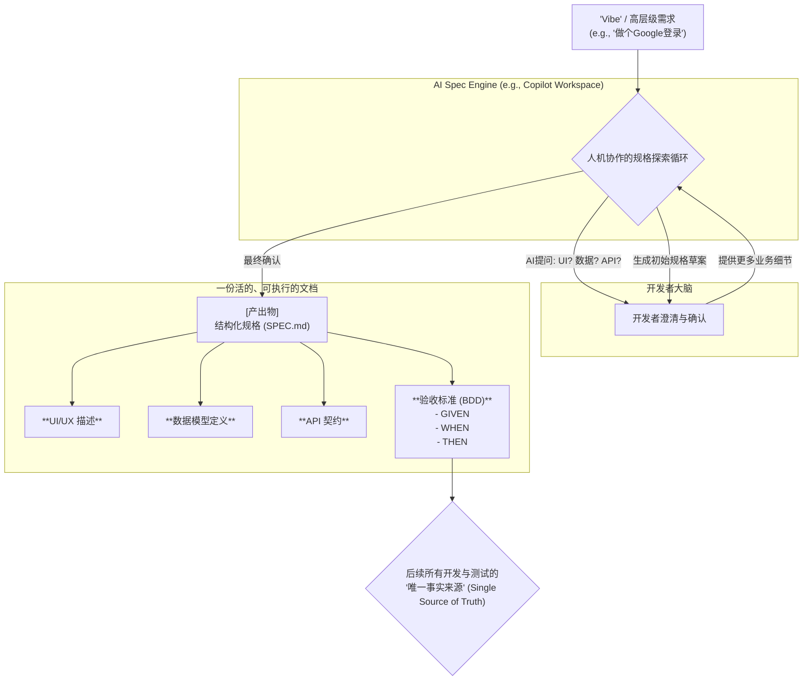
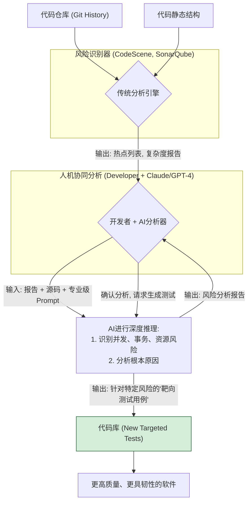
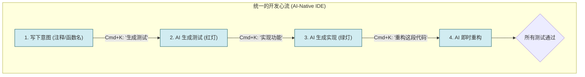
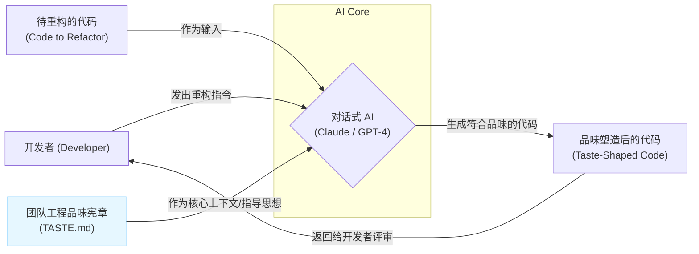
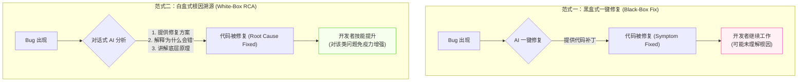

### **AI 时代的 TDD/BDD 深度集成蓝图：技术研究报告 (第一部分)**

**报告摘要:**
本报告旨在深度剖析在人工智能（AI）浪潮下，特别是2025年之后，测试驱动开发（TDD）与行为驱动开发（BDD）如何与 AI 编码工具进行深度融合与进化。报告将摒弃表面化的功能罗列，致力于挖掘两者结合后在软件开发生命周期各个维度中引发的核心转变、涌现出的新型实践范式，以及可供团队直接借鉴与落地的工作流。本报告的目标是为一线开发者、技术管理者和架构师提供一张关于未来软件工程的真实、精准且可落地的挖掘蓝图。

---

### **维度零：源起与演进 —— TDD/BDD 的前世今生与当前基石**

#### **1. 核心脉络：思想的恒定与实践的困境**

TDD (Test-Driven Development) 与 BDD (Behavior-Driven Development) 的思想根基，在数十年的发展中已证明其强大的生命力。

*   **TDD 的核心价值：** 由 Kent Beck 等人倡导，其核心并非“测试”，而是“设计”。“红-绿-重构” (Red-Green-Refactor) 的循环是一种强制性的约束，迫使开发者在编写功能代码前，必须从使用者的角度思考代码的接口、行为和边界。这种“测试先行”的实践，产出的不仅仅是一个高覆盖率的测试套件，更是一个结构清晰、低耦合、高内聚、易于维护的软件设计。它是一种将“思考”前置于“编码”的强大纪律。

*   **BDD 的核心价值：** 作为 TDD 的演进，BDD 将焦点从“单元测试”提升到了“业务行为”。由 Dan North 提出，BDD 强调使用一种业务人员、测试人员和开发人员都能理解的通用语言（如 Gherkin 语法：`Given-When-Then`）来描述软件的期望行为。其核心价值在于**“达成共识”**。BDD 试图在代码被编写出来之前，通过具体的、可执行的规格说明（Executable Specifications），消除需求传递过程中的信息衰减和歧义，确保开发团队交付的是真正满足业务需求的价值。

然而，尽管理念深入人心，TDD/BDD 在过去数十年的推广中始终面临着巨大的挑战：

1.  **高昂的学习曲线与心智负担：** “红-绿-重构”的循环需要开发者在不同思维模式（测试设计、功能实现、代码优化）之间频繁切换，这本身就是一种认知负荷。对于初学者，写出一个“好的”测试，往往比写出实现代码更难。
2.  **显著的流程摩擦：** 在传统 IDE 中，完成一次 TDD 循环，开发者需要手动创建测试文件、编写测试骨架、运行测试、切换到实现文件、编写代码、再次运行测试、最后进行重构。这个过程充满了繁琐的操作，极大地破坏了开发的“心流”（Flow）。
3.  **实践的复杂性与僵化：** 尤其在 BDD 实践中，维护大量的 Gherkin 特征文件、步骤定义（Step Definitions）与底层代码的胶水层，本身就是一项巨大的工程。当业务逻辑频繁变更时，这种维护成本甚至会劝退许多团队。

#### **2. 时代意义的精准解读：AI 杠杆的力量**

进入2025年，以大型语言模型（LLM）为核心的 AI 编码工具（如 GitHub Copilot、Claude Code、Cursor、Trae 等）的革命性意义，不在于它们发明了新的软件工程理论，而在于它们为解决上述 TDD/BDD 的历史性困境提供了**一个前所未有的强大杠杆**。

AI 的角色，是**TDD/BDD 理念的终极“加速器”和“摩擦力消除器”**。它通过以下方式，以极低的成本克服了推广数十年来的核心障碍：

*   **自动化心智切换：** AI 可以在毫秒间完成从“编写测试”到“生成实现”的角色转换，将开发者的心智负担从“如何做”转变为“做什么”。
*   **消除流程摩擦：** AI 原生 IDE 或插件可以将“红-TDD/BDD 深度集成蓝图：技术研究报告 (第一部分)绿-重构”的步骤从手动操作变为“一键式”或自然语言指令驱动的自动化流程。
*   **连接语言与代码：** AI 能够深刻理解自然语言（包括 Gherkin），并将其与代码实现直接关联，极大地降低了维护 BDD 中“通用语言”与“胶水代码”之间映射关系的成本。

因此，AI 时代下的 TDD/BDD 不再仅仅是一套需要意志力去维持的“最佳实践”，而是演变为一种在 AI 辅助下极其顺滑、自然且高效的开发范式。这正是我们进行本次深度挖掘的时代背景与核心基石。

---

### **维度一：从“需求翻译”到“规格探索” (From Requirement Translation to Specification Discovery)**

#### **1. 核心转变：人机协作的规格生成**

在传统开发模式中，需求的起点通常是一份文档、一张原型图或一段对话。开发者需要扮演“翻译官”的角色，将这些模糊、非结构化的信息单向地翻译成具体的代码实现。这个过程充满了风险，因为人的理解存在偏差，细节容易被遗漏。

在 AI 时代，这个起点发生了根本性的转变。开发者不再是孤独的翻译官，而是与 AI 共同进行**“规格探索（Specification Discovery）”**的“探索者”。起点变成了一个高层级的意图（Vibe）或一个简单的提示（Prompt）。

**核心转变在于：** TDD/BDD 的起点不再是“阅读需求文档”，而是**“与 AI 共同生成一份包含了可执行验收标准的、结构化的、无歧义的规格说明书（Specification）”**。

#### **2. 核心范例工具与思想：KIRO.Spec / GitHub Copilot Workspace**

这两个工具（或其代表的思想）完美地诠释了“规格探索”这一理念。它们的设计初衷就是将一个模糊的、自然语言表达的需求，转化为一份详尽的、可作为开发蓝图的规格文档。这与 BDD “在编码前建立共享理解”的理念不谋而合。

**实践场景深度解析：**

假设开发者接到一个任务，其初始“Vibe”是：**“为我们的电商平台构建一个支持 Google 账号登录的用户认证流程。”**

在传统的流程中，开发者可能需要去追问产品经理无数细节。而在“规格探索”模式下，工作流如下：

1.  **输入 Vibe：** 开发者在 Copilot Workspace 或类似工具中输入上述 Vibe。
2.  **AI 引导与澄清：** AI 不会立即生成代码。相反，它会像一个资深的需求分析师一样，开始提问或直接提出一份草案供确认：
    *   “好的，为了构建这个认证流程，我们需要明确以下几个方面：”
    *   “**用户界面：** 是否需要一个专门的登录页面？还是在现有弹出框中增加一个‘使用 Google 登录’的按钮？”
    *   “**数据模型：** 当新用户通过 Google 首次登录时，我们是否需要在 `Users` 表中创建一个新记录？需要存储哪些来自 Google 的信息（如 `google_id`, `email`, `name`, `avatar_url`）？”
    *   “**API 端点：** 我建议设立两个后端端点：`POST /auth/google/initiate` 用于重定向到 Google 授权页，以及 `GET /auth/google/callback` 用于处理 Google 的回调请求。您同意吗？”
    *   “**核心行为与验收标准：** 我已经根据您的要求，草拟了以下验收测试场景，请审阅：”

3.  **生成结构化规格（The Spec）：** 经过几轮快速的人机交互与确认后，AI 会生成一份结构化的`SPEC.md`文档。这份文档就是后续一切开发与测试的“圣经”，其内容可能如下：

    ```markdown
    # Feature: Google OAuth Authentication

    ## 1. Overview
    Allow users to sign up and log in to our e-commerce platform using their Google account to provide a seamless authentication experience.

    ## 2. UI/UX Flow
    - On the `/login` page, a "Sign in with Google" button should be present.
    - Clicking the button redirects the user to the Google OAuth consent screen.
    - After successful authentication with Google, the user is redirected back to our application.

    ## 3. Data Model (`User` table)
    - `id`: UUID (Primary Key)
    - `email`: VARCHAR(255) (Unique)
    - `name`: VARCHAR(255)
    - `google_id`: VARCHAR(255) (Unique, Indexed)
    - `avatar_url`: TEXT
    - `created_at`: TIMESTAMP
    - `last_login_at`: TIMESTAMP

    ## 4. API Endpoints
    - **`POST /api/v1/auth/google/initiate`**
      - **Action:** Generates the Google OAuth URL and returns it.
      - **Response:** `{ "redirect_url": "https://accounts.google.com/o/oauth2/v2/auth?..." }`
    - **`GET /api/v1/auth/google/callback`**
      - **Action:** Handles the callback from Google, exchanges the code for a token, retrieves user info, creates or updates the user in the database, generates a JWT session token, and sets it in a secure cookie.
      - **Success Response:** Redirect to `/dashboard`.
      - **Error Response:** Redirect to `/login?error=auth_failed`.

    ## 5. Acceptance Criteria (BDD Style)

    **Scenario: Existing user logs in with Google**
    *   **Given** a user exists in the database with the email "user@example.com" and a linked `google_id`.
    *   **And** the user is on the login page.
    *   **When** the user clicks "Sign in with Google" and successfully authenticates with Google.
    *   **Then** the system should update their `last_login_at` timestamp.
    *   **And** they should be redirected to the "/dashboard".

    **Scenario: New user signs up with Google**
    *   **Given** no user exists in the database with the email "newuser@example.com".
    *   **When** the user clicks "Sign in with Google" and successfully authenticates with a new Google account.
    *   **Then** a new user record should be created in the database with their Google profile information.
    *   **And** they should be redirected to the "/dashboard".

    **Scenario: Google authentication fails**
    *   **When** the user attempts to sign in with Google but authentication fails or is denied.
    *   **Then** they should be redirected back to the "/login" page with an error message "Google authentication failed."
    ```

这个过程，就是将 BDD 的核心思想——通过具体示例进行沟通——发挥到了极致。这份由人机协作产生的 Spec，其质量和完整性远超传统模式下由个人“翻译”的需求。

#### **3. 挖掘方向与实践指南**

*   **Spec-Driven Development 的最佳实践：**
    *   **Vibe 的艺术：** 如何编写高质量的“Vibe”？关键在于提供**上下文（Context）**和**意图（Intent）**，而不仅仅是功能。
        *   **差的 Vibe:** "做个登录页"。
        *   **好的 Vibe:** "为我们的移动端 App (上下文) 创建一个用户登录流程 (功能)，目标是提升新用户转化率 (意图)。考虑支持手机号+验证码快速登录，并集成微信一键登录 (具体要求)。"
    *   **迭代式探索：** 不要期望一步到位。将与 AI 生成 Spec 的过程看作是一个微型的、迭代式的需求评审会议。不断追问、修正和细化，直到 Spec 稳定。

*   **工具对比 (KIRO.Spec vs. Copilot Workspace)：**
    *   **KIRO.Spec (思想):** 更侧重于 Spec 本身的纯粹性和正确性，可能更适合与形式化验证、模型检查等更严格的工程方法结合。它的目标是产出“数学般精确”的规格。
    *   **Copilot Workspace:** 更加工程化和实用主义。它生成的 Spec 与其后续的 Agent 执行能力（自动生成代码、修改文件、运行测试）紧密耦合。它的目标是成为从“想法”到“可用软件”的最短路径。对于大多数敏捷团队，Copilot Workspace 的模式可能更易于落地。

*   **思想延伸 (无专业工具的团队)：**
    *   即便没有这些前沿工具，任何团队都可以立即借鉴“Vibe->Spec”的思想。
    *   **实践方法：**
        1.  创建一个共享的 Markdown 文档（例如在 Confluence 或 Notion 中）。
        2.  指定一个“AI 协调员”角色。
        3.  在需求评审会上，将会议的讨论作为 Vibe，由协调员使用 **Claude Code** 或 **GPT-4** 的长对话能力，实时地将讨论内容结构化，填充到预设的 Spec 模板（类似上面的例子）中。
        4.  **对话示例：**
            *   **协调员 (对 Claude):** “我们正在讨论 Google 登录。团队成员提到需要处理一个边缘情况：如果用户先用邮箱注册，后来又想绑定同一个邮箱的 Google 账号，应该如何处理？”
            *   **Claude:** “这是一个很好的问题，被称为‘账户合并’或‘账户链接’。建议的处理流程是：当检测到 Google 邮箱已存在于数据库但 `google_id` 为空时，提示用户输入密码以验证身份。验证通过后，将 `google_id` 填入现有账户，完成链接。我为您生成一个新的验收标准场景来描述这个行为，可以吗？”
        5.  通过这种方式，团队利用了 LLM 强大的结构化信息和发现边缘场景的能力，手动完成了一个高质量的 Spec 定义过程，其效果远超传统的会议纪要。

#### **4. 可视化图示：从 Vibe 到 Spec 的演进**


这张图清晰地展示了从一个模糊的 Vibe 开始，通过人机协作的迭代循环，最终产出一份详尽、结构化的规格文档的全过程。这份文档正是 AI 时代 BDD 实践的全新起点，它让“在正确理解之上构建”从一句口号变为了一个可落地的工程实践。

---

### **AI 时代的 TDD/BDD 深度集成蓝图：技术研究报告 (第二部分)**

---

### **维度二：从“代码覆盖率”到“风险洞察力” (From Code Coverage to Risk Insight)**

#### **1. 核心转变：超越指标，洞见风险**

长久以来，代码覆盖率（Code Coverage）被用作衡量测试完备性的黄金标准。然而，它是一个具有欺骗性的指标。100% 的覆盖率只能证明每一行代码都被测试“执行”过，但无法保证：

*   **执行的正确性：** 测试断言是否有效？是否覆盖了所有的逻辑分支和边界条件？
*   **业务的关键性：** 被频繁修改、业务价值极高、或与外部系统强耦合的关键代码，是否得到了与其重要性相匹配的、更深入的测试？
*   **非功能性风险：** 代码是否存在性能瓶颈、并发冲突、资源泄露等在常规功能测试中难以暴露的深层次风险？

在 AI 时代，测试的目标正在发生质的飞跃：从追求表面的“代码覆盖率”百分比，转向更有价值的、由数据驱动的**“风险洞察力”**。这意味着，我们不再平均地测试所有代码，而是将最宝贵的测试资源和最精密的分析能力，集中投入到那些最有可能出现问题、一旦出问题影响最大的代码区域。

**核心转变在于：** AI 并不直接取代传统分析工具，而是作为一种强大的**“推理和分析引擎”**，消费这些工具的输出，将孤立的、静态的数据点（如复杂度、修改频率）转化为可操作的、关于潜在风险的深刻洞见，并主动设计出用于验证这些风险的测试用例。

#### **2. 核心范例工具与思想：AI 对话模型 + 传统分析工具**

当前，没有任何一款主流 AI 编码工具将“风险洞察”作为其核心宣传功能。直接声称它们能做这件事是牵强的。然而，这是一个典型的**应用模式创新**，即通过**“组合使用”**现有工具，可以创造出 1+1 > 2 的效果。

*   **风险识别器 (The 'Where')：** **CodeScene, SonarQube, Git Analytics** 等。这些工具擅长从代码库的历史和结构中挖掘数据，识别出“热点代码”（Hotspot，即高频修改且复杂度高的代码）、高复杂度模块、或是违反特定规则的代码。它们能告诉我们应该把注意力放在**哪里**。
*   **风险分析器 (The 'Why' & 'How')：** **Claude Code, GPT-4** 等顶尖对话式 AI。这些模型拥有强大的代码理解、逻辑推理和知识关联能力。在获得“热点代码”这一关键上下文后，它们能扮演领域专家的角色，分析**为什么**这里有风险，以及**如何**设计测试来暴露它。

**实践场景深度解析：**

假设团队正在维护一个复杂的订单处理微服务。

1.  **第一步：数据驱动的风险定位**
    *   团队定期运行 **CodeScene** 分析代码仓库。分析报告指出，`OrderProcessingService.java` 文件是一个典型的“大脑方法（Brain Method）”聚集地，并且是过去三个月内修改次数最多的文件之一，认知复杂度（Cognitive Complexity）高达 58。
    *   **产出物：** 一个清晰的、数据支持的目标 -> `OrderProcessingService.java` 中的 `processOrder` 方法是我们的头号风险点。

2.  **第二步：人机协同的深度分析与测试生成**
    *   开发者将 CodeScene 的报告摘要和 `processOrder` 方法的源码，一同提交给 **Claude Code**。
    *   **关键在于 Prompt 的设计，它不再是简单的“为我写测试”，而是赋予 AI 角色和上下文的指令：**

        > **Prompt:**
        > “你是一位在分布式系统和高并发电商领域有15年经验的资深架构师。下面这段 Java 代码来自我们的订单处理服务，CodeScene 工具已将其标记为高风险‘热点’（高频修改、高复杂度）。
        >
        > **[CodeScene 报告摘要]**
        > *   文件: `OrderProcessingService.java`
        > *   方法: `processOrder()`
        > *   认知复杂度: 58
        > *   过去3个月提交次数: 42
        >
        > **[Java 代码]**
        > `public void processOrder(Order order) { ... // 一段长而复杂的代码 }`
        >
        > **你的任务是：**
        > 1.  **深度审计这段代码**，找出最可能被忽视的潜在风险。请特别关注：
        >     a. **并发与竞态条件**：如果多个线程同时处理同一个用户的订单，会发生什么？
        >     b. **资源管理**：是否存在未关闭的数据库连接或文件流？
        >     c. **事务边界**：扣减库存、创建支付单、发送通知邮件这几个步骤，是否被正确地包裹在同一个事务中？如果中间一步失败，回滚逻辑是否可靠？
        > 2.  **为每一个你识别出的具体风险点，设计一个专门的 JUnit 5 测试用例**。这个测试用例的目标不是提升覆盖率，而是要精准地模拟出能够触发该风险的场景。”

3.  **第三步：AI 产出风险洞察与靶向测试**
    *   Claude 可能不会立即给出完美的测试代码，但它会提供深刻的分析：

        > **Claude 的回应 (示例):**
        > “分析完毕。这段 `processOrder` 方法确实存在几个严重的风险点：
        >
        > *   **风险1：非原子性操作导致库存超卖。** 代码先读取库存，然后在内存中判断，最后再更新库存。这是一个典型的 Check-Then-Act 模式，在高并发下会导致竞态条件。
        > *   **风险2：事务边界不完整。** 代码在扣减库存后，调用了一个外部的邮件通知服务。如果邮件服务超时或失败，整个订单处理逻辑没有回滚已扣减的库存，将导致数据不一致。
        >
        > **针对风险1的靶向测试用例 (并发测试):**
        > ```java
        > @Test
        > void processOrder_shouldPreventOverselling_underConcurrentAccess() throws InterruptedException {
        >     // GIVEN: 商品库存为 1
        >     Product product = new Product("SKU-123", 1);
        >     productRepository.save(product);
        >
        >     // WHEN: 启动 10 个并发线程，每个线程都尝试购买这唯一的库存
        >     ExecutorService executor = Executors.newFixedThreadPool(10);
        >     AtomicInteger successfulOrders = new AtomicInteger(0);
        >     CountDownLatch latch = new CountDownLatch(10);
        >
        >     for (int i = 0; i < 10; i++) {
        >         executor.submit(() -> {
        >             try {
        >                 Order order = createOrderFor(product);
        >                 orderProcessingService.processOrder(order);
        >                 successfulOrders.incrementAndGet(); // 记录成功订单
        >             } catch (InsufficientStockException e) {
        >                 // 这是预期的失败
        >             } finally {
        >                 latch.countDown();
        >             }
        >         });
        >     }
        >     latch.await(5, TimeUnit.SECONDS);
        >
        >     // THEN: 应该只有一个订单成功，库存变为 0
        >     assertEquals(1, successfulOrders.get());
        >     assertEquals(0, productRepository.findById("SKU-123").get().getStock());
        > }
        > ```
        > **针对风险2的靶向测试用例 (事务回滚测试):**
        > ... (省略) ...”

通过这个流程，团队得到的不再是又一个简单的单元测试，而是一个能够保护系统免受高并发下数据错乱风险的**“安全网”**。这就是从“覆盖率”到“洞察力”的跃迁。

#### **3. 挖掘方向与未来形态**

*   **人机协同工作流研究：** 如何将此模式标准化、流程化？团队可以建立一个“AI 辅助风险审计”的标准操作流程（SOP）。例如，在每个迭代结束后，由架构师或资深开发者使用静态分析工具的报告，结合标准化的 Prompt 模板，对核心模块进行一次“健康检查”。
*   **未来工具的形态预测：** 未来的 AI 原生 IDE 或代码分析平台，将不再是两个独立的工具。我们可以预见一个**“集成的风险洞察仪表盘”**。当开发者打开一个高风险文件时，IDE 的侧边栏会自动弹出 AI 助手的对话窗口，并预加载好上下文：
    *   “`Copilot` 注意到，这个文件在过去一个月被修改了30次，并且包含了复杂的嵌套逻辑。我已经为你初步分析了潜在的三个并发风险点。**[点击查看详情]**。需要我为你生成专门的压力测试来验证这些风险吗？”

#### **4. 可视化图示：风险洞察驱动的测试流程**


---

### **维度三：从“纪律约束”到“即时心流” (From Disciplinary Constraint to Instant Flow)**

#### **1. 核心转变：TDD 循环的摩擦力消融**

传统的 TDD “红-绿-重构”循环，是一项强大的设计纪律，但其过程充满了摩擦力。开发者需要：
1.  **红 (Red):** 手动创建测试文件，编写一个必然失败的测试方法（包含设置、调用、断言），这个过程充满了模板化的样板代码。
2.  **绿 (Green):** 切换到实现文件，编写“最简单”的代码让测试通过。
3.  **重构 (Refactor):** 回到代码中，在保证测试通过的前提下，进行优化和重构。

每一次循环都伴随着文件切换、思维上下文切换和手动编码，这些都像是开发流程中的“减速带”，极大地阻碍了开发者进入并保持高效的“心流”状态（Flow State）。

AI 时代的**核心转变**在于，利用 AI 编码工具将这些“减速带”彻底铲平。AI 将 TDD 的循环步骤从需要意志力维持的“纪律”，变为由工具驱动的、几乎无摩擦的、即时的“心流”。

**核心转变在于：** TDD 循环的周期时间从数分钟缩短到数秒，开发者的心智负担从“如何执行 TDD 步骤”转变为“下一步应该测试什么行为”。

#### **2. 核心范例工具与思想：Trae SOLO / Cursor (作为 AI 原生 IDE)**

这类 AI 原生工具的设计哲学，就是将开发者的“意图”无缝转化为代码。它们将 TDD/BDD 的循环内化为编辑器的核心功能。

**实践场景深度解析 (The 'TDD Flow'):**

让我们在一个 AI 原生 IDE（如 Cursor 或 Trae）中，为购物车添加一个“计算总价”的功能。

1.  **定义行为 (意图)：**
    *   开发者在测试文件 `cart.test.js` 中，仅仅写下一行注释或一个空的测试函数名。
    *   `// test: should correctly calculate the total price of all items`

2.  **一键生成测试 (瞬间抵达‘红灯’):**
    *   开发者选中这行注释，按下 `Cmd+K` (或右键菜单)，输入指令：“**Generate a test case for this behavior. Include items with different quantities and prices.**”
    *   **AI 瞬间生成完整的测试代码：**
        ```javascript
        test('should correctly calculate the total price of all items', () => {
          // GIVEN
          const cart = new Cart();
          cart.addItem({ id: 1, name: 'Apple', price: 0.5 }, 3); // 1.5
          cart.addItem({ id: 2, name: 'Banana', price: 0.3 }, 5); // 1.5
          
          // WHEN
          const totalPrice = cart.calculateTotalPrice();
          
          // THEN
          expect(totalPrice).toBe(3.0); 
        });
        ```
    *   运行测试，立即失败（`cart.calculateTotalPrice is not a function`）。**整个“红灯”阶段，耗时不到5秒，开发者几乎没有进行任何手动编码。**

3.  **一键生成实现 (瞬间抵达‘绿灯’):**
    *   IDE 甚至能自动感知到错误。开发者只需将光标定位到 `calculateTotalPrice`，或者在聊天窗口中输入：“**Implement the `calculateTotalPrice` method to pass the failing test.**”
    *   **AI 在 `Cart.js` 中自动添加实现代码：**
        ```javascript
        class Cart {
          constructor() {
            this.items = [];
          }
          addItem(product, quantity) { /* ... */ }

          // AI-generated implementation
          calculateTotalPrice() {
            return this.items.reduce((total, item) => {
              return total + (item.product.price * item.quantity);
            }, 0);
          }
        }
        ```
    *   自动或手动再次运行测试，测试通过。**“绿灯”阶段完成，同样是秒级响应。**

4.  **对话式重构 (在心流中优化):**
    *   开发者看着新生成的代码，觉得还不错，但想让它更健壮。他选中 `calculateTotalPrice` 方法，再次与 AI 对话：“**Refactor this. What if the items array is empty? Also, use a more descriptive variable name instead of 'total'.**”
    *   **AI 实时重构代码：**
        ```javascript
        // AI-refactored implementation
        calculateTotalPrice() {
          if (this.items.length === 0) {
            return 0;
          }
          return this.items.reduce((cumulativePrice, item) => {
            return cumulativePrice + (item.product.price * item.quantity);
          }, 0);
        }
        ```
    *   所有测试依然通过。重构完成。整个“红-绿-重构”循环在一个编辑器窗口内，通过几次自然语言指令流畅完成，开发者的思绪从未中断。

#### **3. 挖掘方向与新瓶颈分析**

*   **交互效率对比研究：**
    *   可以设计量化实验来对比传统 TDD 与 AI-TDD。
    *   **衡量指标：**
        *   **平均 TDD 循环时间：** 从写下测试意图到重构完成的端到端时间。
        *   **心智负荷指标：** 例如，通过 NASA-TLX 问卷评估开发者在任务后的主观心智负荷。
        *   **上下文切换次数：** 在一次 TDD 循环中，开发者切换文件或应用的次数。
    *   预期结果将明确显示 AI 流程在效率和开发者体验上的巨大优势。

*   **新瓶颈分析：当编码摩擦消失之后，瓶颈在哪？**
    *   **决策速度 (Decision Velocity)：** 瓶颈从“编码的速度”转移到了“思考和决策的速度”。AI 可以快速给出多个实现或重构方案，但开发者需要快速判断哪个方案在架构上更优、更符合团队规范、更能应对未来的变化。开发者的核心价值，从“代码实现者”变成了“**方案决策者**”。
    *   **AI 输出的评审能力 (Review Competency)：** AI 生成的代码可能看似正确，但可能包含微妙的逻辑错误、性能陷阱或安全漏洞。开发者需要具备极高的代码品味和批判性思维，才能快速、准确地评审 AI 的产出。这要求开发者有更深厚的基础知识和更丰富的经验。未来的高级工程师，其核心竞争力之一就是**“AI 代码审计能力”**。
    *   **需求分解的粒度 (Decomposition Skill)：** 由于 TDD 循环变得极快，开发者需要能够以更快的速度，将一个大需求分解成一系列微小的、可测试的行为。瓶颈转移到了前端的“需求分析与任务拆分”上。

#### **4. 可视化图示：TDD 循环的演变**

**传统 TDD 循环 (高摩擦力)**
```mermaid
graph TD
    subgraph "心智模式: 测试设计"
        A["1. 手动创建/打开\n`test.js`文件"];
        A --> B["2. 手动编写\n测试骨架和断言"];
    end
    B --> C{运行测试 (失败)};

    subgraph "心智模式: 功能实现"
        C -- "上下文切换" --> D["4. 手动打开\n`impl.js`文件"];
        D --> E["5. 手动编写\n最简单的实现代码"];
    end
    E --> F{运行测试 (通过)};

    subgraph "心智模式: 代码优化"
        F -- "上下文切换" --> G["7. 在`impl.js`中\n思考并手动重构"];
        G --> H["8. 在`test.js`中\n可能需要调整测试"];
    end
    H --> I{再次运行所有测试 (通过)};

    style A fill:#f8d7da,stroke:#721c24
    style D fill:#f8d7da,stroke:#721c24
    style G fill:#f8d7da,stroke:#721c24
```

**AI 时代 TDD 循环 (即时心流)**

这两张图的对比，直观地展示了 AI 如何通过消除冗余步骤和心智切换，将原本繁琐的纪律，转变为一种流畅、高效、甚至充满创造乐趣的“心流”体验。


---

### **AI 时代的 TDD/BDD 深度集成蓝图：技术研究报告 (第三部分)**

---

### **维度四：从“模式应用”到“品味塑造” (From Pattern Application to Taste Shaping)**

#### **1. 核心转变：从“标准答案”到“个性化表达”**

在过去的软件工程实践中，“重构”和“设计模式”常常被视为一种寻找“标准答案”的过程。面对一段冗长的代码，我们可能会机械地套用“提取方法（Extract Method）”；面对复杂的条件逻辑，我们会想到“策略模式（Strategy Pattern）”。这是一种基于模式目录的、相对客观的应用过程。

然而，优秀的软件团队不仅仅是设计模式的应用者，他们更是**“工程品味（Engineering Taste）”**的塑造者。这种“品味”是一种高度主观、难以言传的集体偏好，它包含了团队对代码可读性、错误处理哲学、架构风格、命名美学等一系列非功能性特质的共同追求。

AI 时代的**核心转变**在于，重构不再是机械地应用通用模式，而是**通过与 AI 的深度对话，将团队独特的、微妙的“工程品味”注入到代码之中，使代码成为团队工程文化的“活化石”**。

**核心转变在于：** AI，特别是顶尖的对话式大语言模型，成为了“工程品味”的理解者、翻译者和执行者，将这种过去只能靠资深工程师言传身教的隐性知识，变为了可以被描述、被学习、被规模化应用的显性能力。

#### **2. 核心范例工具与思想：Claude Code / GPT-4 (在长对话环境中)**

塑造“品味”这种高度抽象和主观的任务，是大型、强推理、支持长上下文对话的语言模型的绝对强项。这并非特定工具的某个按钮功能，而是其核心认知能力的直接体现。它们能理解的不仅仅是“做什么”，更是“以何种风格/哲学去做”。

**实践场景深度解析：**

假设一个团队对错误处理有自己独特的“品味”，他们信奉“铁路导向编程（Railway Oriented Programming, ROP）”，即函数返回值永远是两种轨道（成功轨道或失败轨道）之一，通过函数组合来构建健壮的数据处理管道，从而避免使用传统的 `try-catch` 或返回 `null`。

**场景：** 一位新成员编写了一段处理用户输入的代码，功能正确，但风格不符合团队“品味”。

**“前品味”代码 (Before Taste-Shaping):**
```javascript
function processUserData(userId) {
  try {
    const user = db.findUserById(userId);
    if (!user) {
      return null; // 不符合品味：返回 null
    }

    const profile = api.fetchUserProfile(user.apiToken);
    if (!profile.isActive) {
      console.error("User is inactive"); // 不符合品味：副作用和不明确的错误处理
      return null;
    }

    const processedData = process(profile.data);
    return processedData; // 成功路径
  } catch (error) {
    logError(error); // 不符合品味：宽泛的 try-catch
    return null;
  }
}
```

**与 AI 对话进行“品味塑造”：**

开发者在 Cursor 或任何支持长对话的编辑器中，选中这段代码，并向 **Claude Code** 发出指令：

> **Prompt:**
> “你是一位熟悉我们团队工程品味的 AI 助手。请重构下面这段 JavaScript 代码。
>
> **我们的‘品味’是：**
> 1.  **严格遵循铁路导向编程（ROP）原则。** 不要返回 `null`，也不要使用 `try-catch` 来控制业务流程。所有函数都应该返回一个结果对象，形如 `{ success: true, value: ... }` 或 `{ success: false, error: '...' }`。
> 2.  **函数式编程风格。** 倾向于使用纯函数和函数组合，代码应该是声明式的，而不是指令式的。
> 3.  **无副作用。** 函数内部不应有 `console.log` 或其他副作用。
>
> 请用这个‘品味’来重构它。”

**“后品味”代码 (After Taste-Shaping) - 由 AI 生成：**
```javascript
// AI 可能先定义 ROP 的辅助函数
const Success = (value) => ({ success: true, value });
const Failure = (error) => ({ success: false, error });

const bind = (result, func) => 
  result.success ? func(result.value) : result;

// AI 重构的函数
const findUser = (userId) => {
  const user = db.findUserById(userId);
  return user ? Success(user) : Failure('User not found');
};

const fetchActiveProfile = (user) => {
  const profile = api.fetchUserProfile(user.apiToken);
  return profile.isActive ? Success(profile) : Failure('User profile is inactive');
};

const processProfileData = (profile) => {
    try {
        const processed = process(profile.data);
        return Success(processed);
    } catch (e) {
        return Failure('Data processing failed');
    }
};

// AI 构建的“铁路”
function processUserData(userId) {
  let result = findUser(userId);
  result = bind(result, fetchActiveProfile);
  result = bind(result, processProfileData);
  return result;
}
```
**AI 的解释：** “我已经按照您的‘品味’文档重构了代码。现在 `processUserData` 是一个清晰的、由三个步骤组成的‘铁路’。每一步（`findUser`, `fetchActiveProfile`, `processProfileData`）都是一个独立的、可测试的函数，它们都返回 `Success` 或 `Failure` 对象。我们使用 `bind` 函数来组合它们，任何一步失败，后续步骤都会被自动跳过，直接传递失败结果。这完全符合您团队的 ROP 和函数式编程哲学。”

#### **3. 挖掘方向与实践指南**

*   **“品味”的量化与描述：创建“团队工程品味宪章” (`TASTE.md`)**
    *   这是一份至关重要的文档，是喂给 AI 的高质量上下文。它应该包含：
        1.  **核心哲学与原则：** 如“可读性优先于性能”、“拥抱不可变性”、“错误是数据，不是异常”。
        2.  **架构与设计模式偏好：** “我们倾向于使用六边形架构”、“对于跨模块通信，优先选择事件驱动而非直接调用”。
        3.  **设计模式禁忌：** “禁止使用单例模式”、“避免使用继承，优先选择组合”。
        4.  **错误处理范式：** 明确定义团队选择的错误处理方式（如 ROP、Either Monad、或特定异常策略）。
        5.  **命名与风格约定：** 描述性的命名法，对异步函数的命名规则（如 `...Async` 后缀）等。
    *   这份文档可以被固定在 Copilot Enterprise 或 Cursor for Teams 的上下文中，成为所有 AI 操作的“指导思想”。

*   **多模型交叉评审 (AI Cross-Review)：**
    *   这是一个前沿的实践：让一个模型（如 Claude）根据 `TASTE.md` 生成或重构代码，然后将结果（代码 + `TASTE.md`）提交给另一个模型（如 GPT-4），并指令其扮演“代码评审员”的角色，检查代码是否完美遵循了团队品味。
    *   **有效性分析：** 这种“AI 交叉评审”可以有效发现单个模型因其自身训练数据偏好而导致的“品味漂移”，起到类似“双人代码评审”中第二双眼睛的作用，进一步确保工程质量的一致性。

#### **4. 可视化图示：品味塑造工作流**


---

### **维度五：从“错误修复”到“根因溯源” (From Bug Fixing to Root Cause Analysis)**

#### **1. 核心转变：从“创可贴”到“病理报告”**

传统的调试和错误修复，其首要目标是让失败的测试变绿，让崩溃的应用恢复运行。这往往导致开发者采取最直接、最快速的修复方式，如同贴上一张“创可贴”。这种修复可能解决了表面症状，但并未触及问题的根本原因，为未来埋下更深的技术债务。

AI 时代的**核心转变**在于，最佳的 AI 助手不仅仅是“修复者（Fixer）”，更是“**根本原因分析师（Root Cause Analyst）**”。它将每一次错误都视为一次宝贵的学习和系统强化机会。

**核心转变在于：** 修复 Bug 的过程从一个“黑盒式”的一键修复，演变为一个“白盒式”的、带有深度解释和教学意义的诊断过程。AI 的价值从“提供答案”跃升为“传授知识”。

#### **2. 核心范例：不同 AI 助手的层次化能力**

各家工具在此维度的能力表现出明显的分层：

*   **层次1：一键修复 (e.g., 初代 Copilot 'Fix Bug')**
    *   **行为：** 基于对大量代码的统计学习，直接给出最有可能的修复方案。
    *   **优点：** 快速，对于拼写错误、简单的 API 误用等问题非常高效。
    *   **缺点：** “知其然，不知其所以然”。开发者可能不理解修复背后的原理，无法举一反三。

*   **层次2：对话式修复与溯源 (e.g., Claude, 对话模式下的 Copilot)**
    *   **行为：** 不仅提供修复方案，更通过对话，引导开发者理解问题的本质。
    *   **优点：** 兼具修复与教学功能，能将开发者的能力提升与问题解决同步进行。

**实践场景深度解析：**

**Bug 场景：** 在一个 React 应用中，一个组件从 API 获取数据并展示，但当数据更新时，UI 偶尔不刷新。这是一个经典的由对 React Hooks 规则理解不深导致的 Bug。

**“一键修复”式 AI 的响应：**
AI 可能会直接修改 `useEffect` 的依赖数组，从 `[]` 改为 `[data]`。问题解决了，但开发者可能只是记住了“这里要加个东西”，下次在不同场景下依然会犯错。

**“根因溯源”式 AI (Claude) 的响应：**

> **开发者:** “我的组件 `UserData` 拿不到最新的数据，UI 不更新。这是代码，帮我修一下。”
> `function UserData({ userId }) { const [user, setUser] = useState(null); useEffect(() => { api.fetchUser(userId).then(setUser); }, []); // 错误在此 return <div>{user?.name}</div>; }`
>
> **Claude:**
> “我看到问题所在了。直接的修复方法是在 `useEffect` 的依赖数组中加入 `userId`：
> `useEffect(() => { ... }, [userId]);`
>
> **但更重要的是理解为什么必须这样做，这涉及到 React 的核心工作原理，即‘闭包陷阱’和依赖数组的作用。**
>
> **根本原因分析：**
> 1.  **Stale Closure (陈旧的闭包):** 当你的 `useEffect` 的依赖数组是 `[]` 时，这个 effect 函数只会在组件首次挂载时运行一次。在这一次运行时，它“捕获”了当时传入的 `userId` 的值。
> 2.  **Props Change:** 当父组件传入一个新的 `userId` 时，`UserData` 组件会重新渲染。但是，由于依赖数组是 `[]`，effect 函数**不会**重新运行。因此，内部的 `api.fetchUser` 调用的依然是第一次渲染时捕获的那个**陈旧的 `userId`**。
> 3.  **The Fix Explained:** 当你把 `userId` 加入依赖数组 `[userId]`，你就在告诉 React：‘请监视 `userId` 这个 prop。一旦它发生变化，就请重新运行这个 effect 函数。’ 这样，每次 `userId` 改变，effect 都会用最新的 `userId` 去获取数据，UI 就能正确更新了。
>
> **结论：** 这个 Bug 的根源不是代码写错了，而是对 React Hooks ‘如何通过依赖数组来同步外部世界与组件状态’ 这一核心心智模型的误解。
>
> **你想深入了解一下‘闭包’在 JavaScript 中是如何工作的吗？这对于理解很多 React 和 JS 的行为至关重要。**”

这个过程，将一次简单的 Bug Fix，升华为一次关于 React 核心机制的微型、情境化的辅导课。

#### **3. 挖掘方向**

*   **对比研究：黑盒修复 vs. 白盒溯源的长期影响**
    *   可以设计一个纵向研究，追踪两组开发者：一组只使用“一键修复”，另一组使用“溯源对话”。在数月后，评估他们在解决同类新问题时的能力、代码质量以及对底层原理的理解深度。这将有力地证明“白盒”模式对开发者成长的长期价值。
*   **价值衡量：**
    *   “黑盒式”修复的价值在于**“平均故障解决时间 (MTTR)”**的降低。
    *   “白盒式”修复的价值在于**“开发者技能提升率”**和**“同类缺陷复现率的降低”**。对于寻求建立长期工程卓越性的团队来说，后者的价值远大于前者。

#### **4. 可视化图示：两种修复范式的对比**



---

### **AI 时代的 TDD/BDD 深度集成蓝图：技术研究报告 (最终部分)**

---

### **维度六：从“技能学习”到“情境式辅导” (From Skill Learning to Contextual Mentorship)**

#### **1. 核心转变：从“通用课程”到“即时导师”**

传统的技能学习模式是“拉取式”和“去情境化”的。开发者需要暂停手头的工作，去阅读书籍、观看视频课程或参加培训，学习 TDD/BDD 的理论知识。当他们回到真实的、复杂的项目中时，往往发现理论与实践之间存在巨大的鸿沟。如何在一个拥有复杂依赖的遗留系统中编写第一个测试？如何优雅地 Mock 一个外部服务？这些具体的问题，通用课程无法解答。

AI 时代的**核心转变**在于，学习过程从“拉取式”变为**“推送式”和“情境化”**。开发者不再需要离开工作流去“学习 TDD”，而是在他们遇到困难的**那一刻**、在他们正在处理的**那段代码**上，获得一个 AI 导师提供的即时、个性化、可操作的辅导。

**核心转变在于：** AI 助手从一个“知识问答机器人”进化为一个“**常伴左右的编程导师（Contextual Mentor）**”。它不仅知道 TDD 的理论，更重要的是，它理解你当前的上下文（你的代码、你的困境、你的目标），并能以苏格拉底式的方式引导你，而不是直接给你答案。

#### **2. 核心范例工具与思想：以 Claude Code 为代表的顶尖对话式 AI**

“辅导”和“教学”能力强依赖于模型的推理、解释和类比能力，这正是当前最顶尖的大语言模型（如 Claude）所擅长的。它们能够进行启发式提问，用简单的比喻解释复杂概念，从而真正点燃学习者思维的火花。

**实践场景深度解析：**

**场景：** 一位初级开发者正在尝试为一个依赖外部支付网关的服务编写单元测试。他知道要写测试，但完全被“如何处理那个外部 `PaymentGateway`”卡住了。

> **开发者 (向 AI 提问):**
> “我想为我的 `OrderService` 的 `submitOrder` 方法写个测试。但是 `submitOrder` 里面调用了 `paymentGateway.charge()`，我一运行测试，它就真的去调用支付接口了，还报错。我该怎么办？”
>
> **一个“问答机器人”可能会说：**
> “你应该使用 Mocking。用 `jest.mock('./paymentGateway')`。” (给出了答案，但没有传授思想)
>
> **一个“情境式导师” (Claude) 会这样回应：**
> “这是一个非常经典且重要的问题！它触及了单元测试的核心思想：**隔离**。
>
> **让我们先思考一下‘为什么’要测试。** 我们测试 `submitOrder` 方法，是想验证它自身的逻辑是否正确（比如，订单状态是否被正确更新？），对吗？我们并不想在这次测试中，把支付网关的功能也一起测试了。支付网关本身应该有它自己的测试。
>
> **把它想象成汽车组装。** 当你测试引擎时，你只需要一个‘假的’变速箱连接器，来确保引擎的输出轴能正确啮合。你不需要一个完整、真实的变速箱来测试引擎本身。
>
> 在我们的代码里，`PaymentGateway` 就是那个‘变速箱’。我们需要一个‘假的’支付网关，它能完全受我们控制。在测试术语里，这个‘假的’东西就叫做 **‘Mock’ (模拟对象)**。
>
> **你的目标是：** 创建一个 `PaymentGateway` 的 Mock 版本。当 `submitOrder` 调用它的 `charge` 方法时，我们可以让这个 Mock：
> 1.  假装成功，并返回一个我们预设的交易 ID。
> 2.  或者，假装失败，并抛出一个我们预设的错误。
>
> 这样，我们就能在不依赖真实网络和外部服务的情况下，完整地测试 `submitOrder` 在成功和失败路径下的所有行为了。
>
> **现在，你想不想我们一起用 Jest 来写出这个 Mock，并看看它是如何在代码里替换掉真实的 `PaymentGateway` 的？**”

这个辅导过程，不仅解决了眼前的问题，还教会了开发者单元测试的“第一性原理”——**测试隔离**，并用一个生动的比喻加深了理解。

#### **3. 挖掘方向**

*   **构建基于 LLM 的“TDD 交互式实战教程”：**
    *   这不再是一个线性的教程，而是一个动态系统。它可以给学习者一个真实的、小型的代码库，并提出任务（“请为用户注册功能添加 TDD 测试”）。
    *   AI 导师会实时观察学习者的每一步操作。如果学习者卡住了，它会像上述场景一样，提供启发式引导。如果学习者写出了一个不好的测试（比如断言不明确），它会提出改进建议，并解释背后的原因。
    *   这种“在实战中学习、在错误中成长、有专家随时指导”的模式，将彻底颠覆传统的软件工程教育。

#### **4. 可视化图示：学习模式的演进**

```mermaid
graph TD
    subgraph "传统技能学习模式 (Pull & De-contextualized)"
        A["开发者遇到 TDD 难题"] --> B["中断工作流"];
        B --> C["去搜索引擎/文档/课程中寻找通用答案"];
        C --> D["尝试将理论知识应用于特定问题 (可能失败)"];
        D --> E["耗时且充满挫败感"];
    end

    subgraph "AI 情境式辅导模式 (Push & Contextual)"
        F["开发者在 IDE 中遇到 TDD 难题"] --> G{AI 导师自动/手动激活};
        G -- "1. '我看到你卡住了，是在处理依赖问题吗？'\n2. '我们来聊聊测试隔离...'\n3. '这是一个代码示例...'" --> H["开发者在不离开 IDE 的情况下获得\n个性化、即时的指导"];
        H --> I["问题解决 + 技能内化"];
    end

    style E fill:#fffbe6,stroke:#faad14
    style I fill:#f6ffed,stroke:#52c41a```
---

### **维度七：从“代码信任”到“契约验证” (From Code Trust to Contract Verification)**

#### **1. 核心转变：从内部正确到外部协同**

TDD/BDD 极大地增强了我们对单个服务或模块内部代码质量的信任。然而，在现代微服务架构中，最大的风险往往不在于服务内部，而在于服务之间的**“边界”**。一个服务（提供者 Provider）的 API 发生了微小但具有破坏性的变更，可能会导致依赖它的所有服务（消费者 Consumer）全部瘫痪。

传统的端到端（E2E）测试试图解决这个问题，但它们运行缓慢、不稳定、维护成本极高。

AI 时代的**核心转变**在于，我们可以利用 AI 大幅降低**“消费者驱动的契约测试（Consumer-Driven Contract Testing, CDCT）”**的实施成本，将服务间的隐式信任，升级为一种可程序化验证的**“显式契约”**。

**核心转变在于：** AI 成为生成和维护这些“契约”代码的强大工具，让原本因实施复杂而未被广泛采用的 CDCT 思想，变得触手可及。AI 负责繁琐的“语法”，开发者则专注于重要的“语义”。

#### **2. 核心范例：AI 代码生成 + 专用测试框架 (如 Pact)**

这是一个典型的**应用模式**维度。AI 工具本身不提供契约测试，但它们可以被训练或引导来理解 CDCT 的理念，并为 Pact、Spring Cloud Contract 等框架生成符合其特定 DSL（领域特定语言）的测试代码和契约文件。

**实践场景深度解析：**

**场景：** `WebApp`（消费者）需要调用 `UserService`（提供者）的 `GET /users/{id}` 接口来显示用户信息。`WebApp` 团队需要确保 `UserService` 返回的数据格式始终是他们所期望的。

**传统流程：** `WebApp` 的开发者需要仔细阅读 Pact.js 的文档，手动编写复杂的测试设置代码，定义交互（interaction），设置 mock server，等等。这个过程非常繁琐。

**AI 辅助的契约测试流程：**

`WebApp` 的开发者在测试文件中，用自然语言向 AI 描述他期望的契约：

> **Prompt:**
> “我正在为我的 `user-api-client.js` 编写一个消费者驱动的契约测试，使用的框架是 **Pact.js**。
>
> **请为我生成一个契约测试，描述以下交互：**
> 1.  **消费者:** `WebApp`
> 2.  **提供者:** `UserService`
> 3.  **交互描述:** 当 `WebApp` 发送一个 `GET` 请求到 `/users/123` 时
> 4.  **期望的响应状态码:** `200`
> 5.  **期望的响应体 (Body):**
    *   必须是一个 JSON 对象。
    *   包含一个 `id` 字段，其值应该像一个数字 `123`。
    *   包含一个 `name` 字段，其值应该像一个字符串，例如 `'John Doe'`。
    *   包含一个 `email` 字段，其值必须是符合 email 格式的字符串。
>
> 请使用 Pact.js 的 `Matchers` 来定义响应体，以增加测试的灵活性。”

**AI (Claude / Copilot) 生成的 Pact.js 测试代码：**
```
```javascript
import { PactV3, MatchersV3 } from '@pact-foundation/pact';
import { UserApiClient } from './user-api-client';

const { like, string, integer } = MatchersV3;

const provider = new PactV3({
  consumer: 'WebApp',
  provider: 'UserService',
});

describe('User Service API Client', () => {
  it('fetches a user by ID successfully', () => {
    // 1. Define the expected interaction (The Contract)
    provider
      .given('a user with ID 123 exists')
      .uponReceiving('a request to fetch a user')
      .withRequest({
        method: 'GET',
        path: '/users/123',
      })
      .willRespondWith({
        status: 200,
        headers: { 'Content-Type': 'application/json' },
        body: like({ // Use matchers for flexibility
          id: integer(123),
          name: string('John Doe'),
          email: string('john.doe@example.com'), // Pact will auto-gen a regex for this format
        }),
      });

    // 2. Run the test against the mock server
    return provider.executeTest(async (mockServer) => {
      const client = new UserApiClient(mockServer.url);
      const user = await client.getUser('123');
      
      // 3. Assert the client code behaves as expected
      expect(user.id).toBe(123);
      expect(user.name).toBe('John Doe');
    });
  });
});
```

这个流程将契约测试的门槛从“学习一个复杂的 DSL”降低到了“用自然语言描述一个 API 交互”。

#### **3. 挖掘方向**

*   **AI 驱动的契约生命周期管理：** AI 不仅可以生成契约，还能在 CI/CD 流程中扮演更积极的角色。例如，当 `UserService` 的开发者试图合并一个修改了 `/users/{id}` 响应体的 PR 时，CI 流程可以自动触发一个 AI Agent，该 Agent 会：
    1.  从 Pact Broker（契约中心）获取所有依赖此接口的消费者契约。
    2.  分析出该变更会违反 `WebApp` 和 `MobileApp` 的契约。
    3.  自动在 PR 下留言：“**警告：此变更将破坏与 `WebApp` 和 `MobileApp` 的契约。请在合并前与相关团队沟通，或更新您的 API 版本。**”

---

### **维度八：从“个体技艺”到“集体智慧” (From Individual Craft to Collective Intelligence)**

#### **1. 核心转变：从知识孤岛到智能联邦**

在任何有一定规模的组织中，都存在着大量的“隐性知识”：为什么这段代码要这样写？那个模块的最佳实践是什么？团队的架构决策历史是怎样的？这些知识分散在资深开发者的大脑中、散落在 Pull Request 的评论里、埋藏在 Confluence 的旧文档里，构成了一个个“知识孤岛”。

AI 时代的**核心转变**在于，我们可以利用企业级的 AI 工具，将整个组织的数字资产（代码库、文档、PR、工单系统）作为一个统一的上下文，训练或微调一个**专属于该组织的“集体智慧大脑”**。

**核心转变在于：** 软件开发从依赖少数英雄的“个体手艺活”，演变为一个由 AI 连接和赋能的、能够自我学习和传承的**“集体智能活动”**。

#### **2. 核心范例：GitHub Copilot Enterprise / Cursor for Teams**

这些企业级工具的核心价值，就是打破知识孤岛。它们通过以下方式实现：

*   **全代码库上下文：** AI 的建议不再局限于当前文件，而是基于对整个企业代码库的理解。
*   **个性化微调：** 可以使用团队的内部文档、代码规范和优秀代码范例，对基础模型进行微调，使其“说行话”、“懂规矩”。
*   **知识沉淀与检索：** 将非结构化的讨论（如 PR comments）转化为可检索的知识。

**实践场景深度解析：**

**场景：** 一位新加入大型金融科技公司的开发者，需要在一个核心交易系统中添加一个新的计费规则。这个系统历史悠久、代码复杂、文档可能过时。

**传统流程：** 这位开发者可能需要花费数天甚至数周的时间：
1.  找导师，但导师很忙。
2.  阅读海量的、可能过时的文档。
3.  在代码库中大海捞针，试图找到类似功能的实现。
4.  小心翼翼地写出代码，然后在 Code Review 中被指出不符合团队的某种“潜规则”。

**企业级 AI 辅助流程：**

开发者在她的 AI 原生 IDE 中，开启与“团队大脑”的对话：

> **开发者:** “我需要在我们的‘Phoenix 交易引擎’中添加一个新的‘分层服务费’规则。这是需求文档的链接：[link-to-confluence]。
>
> **我的问题是：**
> 1.  实现这种业务规则，我们团队推荐的最佳实践或设计模式是什么？有没有可以参考的、类似的现有规则实现？
> 2.  计费规则的 TDD 测试应该放在哪个目录下？测试的基类应该继承自哪个？
> 3.  修改计费逻辑，通常需要注意哪些潜在的回归风险？之前有没有发生过类似的线上问题？”
>
> **“团队大脑” (Copilot Enterprise) 的回应：**
> “欢迎！很高兴为你导航‘Phoenix 交易引擎’。
>
> 1.  **最佳实践：** 根据我们代码库中的 30 多个现有规则分析，团队普遍采用**策略模式（Strategy Pattern）**来实现计费规则。我建议你在 `com.ourbank.phoenix.billing.strategies` 包下创建一个新的 `TieredServiceFeeStrategy` 类。你可以参考 `FlatRateStrategy.java`，它的结构非常清晰，是团队公认的优秀范例。**[点击直接打开 `FlatRateStrategy.java`]**
> 2.  **测试位置：** 对应的单元测试应放在 `src/test/java/com/ourbank/phoenix/billing/strategies/`。请确保你的测试类继承自 `BaseBillingStrategyTest`，它会为你处理好所有必要的 Mock 和上下文设置。**[点击生成测试文件骨架]**
> 3.  **潜在风险：** 在分析了过去两年的 PR 和 Jira 工单后，我发现与计费逻辑相关的最大风险是**精度问题和并发计算**。特别是在 PR #2357 的讨论中，架构师 John Smith 强调了所有涉及金额计算的地方都必须使用 `BigDecimal` 而不是 `double`。我已经在你的 IDE 设置中高亮了所有 `double` 用于金额计算的地方，以防你意外引入此类 Bug。”

这个过程将新人的上手时间从数周缩短到数小时，并且确保了新增代码从一开始就符合团队长期积累下来的集体智慧和最佳实践。

#### **3. 挖掘方向**

*   **衡量 ROI (投资回报率)：** 如何量化“集体智慧”带来的价值？
    *   **新成员生产力曲线：** 测量新开发者从入职到能够独立完成中等复杂度任务的平均时间。
    *   **代码一致性得分：** 使用静态分析工具，衡量引入 AI 前后，代码库在风格、模式应用上的一致性变化。
    *   **Code Review 效率：** 分析 Code Review 中用于讨论“如何做” vs. “做什么”的评论比例变化。AI 解决了大部分“如何做”的问题后，评审可以更专注于业务逻辑的正确性。

---

### **报告总结：从“纪律”到“智能”，TDD/BDD 的文艺复兴**

本报告通过八个维度的深度挖掘，描绘了一幅 AI 时代 TDD/BDD 的全新蓝图。其核心结论是：**AI 并未颠覆或取代 TDD/BDD 的核心思想，恰恰相反，它成为了这些思想有史以来最强大的“放大器”和“实现者”。**

在 AI 的加持下，TDD/BDD 正在经历一场深刻的“文艺复兴”：

*   它从一项需要高度自律才能坚持的**“苦行僧式”的纪律**，演变为一种在 AI 驱动下流畅、自然、甚至充满乐趣的**“心流”**。
*   它关注的焦点从机械的**“代码覆盖率”**和**“模式应用”**，提升到了更具价值的**“风险洞察力”**和**“工程品味塑造”**。
*   它的价值边界从保证**“个体代码”**的内部质量，延伸到了验证**“服务间契约”**的外部协同，并最终沉淀为整个组织的**“集体智慧”**。

对于身处 2025 年之后的开发者和技术团队而言，拥抱这一转变不再是一个选择，而是保持核心竞争力的必然路径。真正的挑战，将不再是“如何编写代码”，而是“如何与 AI 协作，提出正确的问题，做出智慧的决策，并最终构建出真正卓越的软件”。

